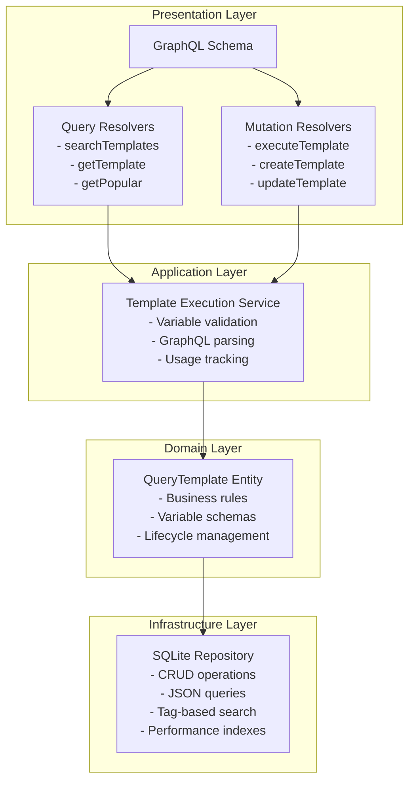

# Template Management Guide

## 📋 Overview

Complete guide for managing GraphQL query templates in the bun-graph-db system. This includes template lifecycle, best practices, and advanced management features.

## 🏗️ System Architecture

The template system follows hexagonal architecture with clean domain boundaries:



### Core Components

1. **QueryTemplate Domain Entity** (`src/domain/entities/QueryTemplate.ts`)
   - Immutable value object with business rules
   - Variable validation and schema management
   - Template applicability and lifecycle methods

2. **IQueryTemplateRepository Interface** (`src/domain/repositories/IQueryTemplateRepository.ts`)
   - Repository contract with search capabilities
   - Advanced filtering by tags, tables, and criteria

3. **SQLiteQueryTemplateRepository** (`src/infrastructure/database/sqlite/SqliteQueryTemplateRepository.ts`)
   - SQL implementation with JSON query support
   - Performance optimized with proper indexing

4. **Template Resolvers** (`src/presentation/graphql/`)
   - GraphQL operations for template management
   - Template execution with variable processing

## 🔄 Template Lifecycle

### 1. Template Creation
```graphql
mutation CreateTemplate {
  createTemplate(input: {
    identifier: "unique-template-id"
    name: "Human Readable Name"
    description: "Clear description of template purpose"
    query: "query TemplateQuery($param: Type!) { ... }"
    variables: { "param": "defaultValue" }
    createdBy: "user-or-system"
  }) {
    template {
      id
      identifier
      name
    }
    errors { message }
  }
}
```

### 2. Template Discovery
```graphql
# Basic Search
query FindTemplates {
  searchTemplates(
    filter: { isActive: true }
    pagination: { limit: 20, offset: 0 }
    sort: [{ field: "usageCount", direction: "DESC" }]
  ) {
    nodes {
      id
      identifier
      name
      description
      usageCount
      isActive
      createdAt
      updatedAt
    }
    totalCount
    hasNextPage
    hasPreviousPage
  }
}

# Advanced Search (Template-based)
mutation AdvancedTemplateSearch {
  executeTemplateWithGraphQL(
    templateIdentifier: "search-templates-advanced"
    variables: {
      filter: { isActive: true, search: "table" }
      pagination: { limit: 10, offset: 0 }
      sort: [{ field: "name", direction: "ASC" }]
    }
  ) {
    success
    data
    errors { message }
  }
}
```

### 3. Template Execution
```graphql
mutation ExecuteTemplate {
  executeTemplateWithGraphQL(
    templateIdentifier: "template-identifier"
    variables: { "customParam": "customValue" }
    trackUsage: true
  ) {
    success
    data
    errors { message }
  }
}
```

### 4. Template Updates

#### 4.1 General Template Update
```graphql
mutation UpdateTemplate {
  updateTemplate(
    id: "template-id"
    input: {
      name: "Updated Name"
      description: "Updated description"
      query: "query UpdatedQuery { ... }"  # 새 쿼리 텍스트 업데이트
      variables: { "param": "newValue" }   # 기본 변수 업데이트
      isActive: true
    }
  ) {
    success
    template {
      id
      identifier  
      name
      query       # 업데이트된 쿼리 확인
      updatedAt
    }
    errors { message }
  }
}
```

#### 4.2 Query-Only Update (New Feature)
```graphql
# 전용 쿼리 업데이트 뮤테이션 - 이전 쿼리 추적 기능 포함
mutation UpdateTemplateQuery {
  updateTemplateQuery(
    templateId: "194"
    newQuery: """
      query UpdatedListTables($limit: Int = 25, $offset: Int = 0) {
        tables(pagination: { limit: $limit, offset: $offset }) {
          nodes {
            id
            identifier
            description
            nodeCount
            attributeCount
            createdAt
            updatedAt
          }
          totalCount
          hasNextPage
          hasPreviousPage
        }
      }
    """
    updateVariables: { "limit": 25, "offset": 0 }
  ) {
    success
    template {
      id
      identifier
      name
    }
    errors { message }
    previousQuery  # 롤백을 위한 이전 쿼리 반환
  }
}

# 식별자로 업데이트
mutation UpdateTemplateQueryByIdentifier {
  updateTemplateQuery(
    templateIdentifier: "list-tables-with-pagination"
    newQuery: "query NewQuery { ... }"
  ) {
    success
    template { id identifier }
    previousQuery
  }
}
```

### 5. Template Import/Export (New Feature)

#### 5.1 Template Export
```graphql
# 단일 템플릿 내보내기 (ID로)
mutation ExportTemplate {
  exportTemplate(
    templateId: "194"
    includeStatistics: true  # 사용 통계 포함
  ) {
    success
    exportData    # JSON 문자열 형태로 반환
    filename      # 자동 생성된 파일명 (예: list-tables_v1-0-0.json)
    errors { message }
  }
}

# 식별자로 내보내기
mutation ExportTemplateByIdentifier {
  exportTemplate(
    templateIdentifier: "search-templates-advanced"
    includeStatistics: true
  ) {
    success
    exportData
    filename
    errors { message }
  }
}
```

#### 5.2 Template Import  
```graphql
# JSON 데이터로 템플릿 가져오기
mutation ImportTemplate {
  importTemplate(
    jsonData: """
    {
      "version": "1.0.0",
      "exportedAt": "2025-09-06T14:41:20.571Z",
      "template": {
        "identifier": "test-health-check",
        "name": "System Health Check",
        "description": "시스템 상태 확인 테스트",
        "query": "query HealthCheck { health { status timestamp version } }",
        "operationType": "query",
        "version": "1.0.0",
        "tags": ["general"],
        "isActive": true
      }
    }
    """
    overwriteExisting: false           # 기존 템플릿 덮어쓰기 방지
    generateNewIdentifier: true        # 충돌 시 새 식별자 생성  
    newIdentifierPrefix: "imported"    # 새 식별자 접두사
  ) {
    success
    template {
      id
      identifier  # 새로 생성된 식별자 확인
      name
    }
    errors { message }
    warnings    # 가져오기 중 발생한 경고사항
  }
}
```

#### 5.3 파일 기반 Import/Export 워크플로우
```javascript
// 1. 템플릿 내보내기 및 파일 저장 예제
const exportResult = await graphqlClient.request(`
  mutation {
    exportTemplate(templateId: "194", includeStatistics: true) {
      success
      exportData
      filename
    }
  }
`);

if (exportResult.exportTemplate.success) {
  // 파일로 저장
  const fs = require('fs');
  const exportDir = './exported-templates/';
  const filename = exportResult.exportTemplate.filename;
  
  fs.writeFileSync(
    exportDir + filename, 
    exportResult.exportTemplate.exportData
  );
  
  console.log(`템플릿 내보내기 완료: ${filename}`);
}

// 2. 파일에서 템플릿 가져오기 예제
const fs = require('fs');
const templateFile = './exported-templates/test-health-check_v1-0-0.json';
const jsonData = fs.readFileSync(templateFile, 'utf8');

const importResult = await graphqlClient.request(`
  mutation ImportFromFile($jsonData: String!) {
    importTemplate(
      jsonData: $jsonData
      generateNewIdentifier: true
      newIdentifierPrefix: "file-imported"
    ) {
      success
      template { id identifier name }
      warnings
    }
  }
`, { jsonData });

console.log('가져오기 결과:', importResult.importTemplate);
```

### 6. Template Deletion
```graphql
# Direct Deletion
mutation DeleteTemplate {
  deleteTemplate(id: "template-id") {
    success
    errors { message }
  }
}

# Template-based Deletion
mutation DeleteTemplateById {
  executeTemplateWithGraphQL(
    templateIdentifier: "delete-template-by-id"
    variables: { "templateId": "123" }
  ) {
    success
    data
    errors { message }
  }
}
```

## 📊 Template Analytics and Monitoring

### Usage Statistics
```graphql
query TemplateStats {
  template(id: "template-id") {
    id
    identifier
    name
    usageCount
    lastUsedAt
    avgExecutionTimeMs
    complexityScore
    isActive
    createdAt
    updatedAt
  }
}
```

### Popular Templates
```graphql
query PopularTemplates {
  searchTemplates(
    filter: { isActive: true }
    sort: [{ field: "usageCount", direction: "DESC" }]
    pagination: { limit: 10, offset: 0 }
  ) {
    nodes {
      identifier
      name
      usageCount
      avgExecutionTimeMs
    }
  }
}
```

## 🛠️ Advanced Template Management

### Batch Operations

#### Import Multiple Templates
```typescript
// Example batch import workflow
const templates = [
  { identifier: "template-1", name: "Template 1", query: "..." },
  { identifier: "template-2", name: "Template 2", query: "..." }
];

for (const template of templates) {
  await createTemplate({ input: template });
}
```

#### Export Template Collection
```graphql
query ExportTemplates {
  searchTemplates(
    filter: { isActive: true }
    pagination: { limit: 100, offset: 0 }
  ) {
    nodes {
      identifier
      name
      description
      query
      variables
      operationType
      complexityScore
      tags
      version
      createdAt
      updatedAt
    }
  }
}
```

### Template Validation

#### Pre-execution Validation
```typescript
// Validate template before execution
const validationResult = await validateTemplate({
  query: templateQuery,
  variables: templateVariables
});

if (!validationResult.isValid) {
  console.error('Template validation failed:', validationResult.errors);
  return;
}
```

#### Runtime Validation
- **GraphQL Schema Validation**: Automatic schema compliance checking
- **Variable Type Validation**: Type safety for template variables
- **Query Complexity Analysis**: Automatic complexity scoring
- **Performance Monitoring**: Execution time tracking

## 🔍 Template Discovery Patterns

### By Category
```graphql
# Search by tags
mutation SearchByCategory {
  executeTemplateWithGraphQL(
    templateIdentifier: "search-templates-advanced"
    variables: {
      filter: { tags: ["table", "creation"] }
    }
  ) {
    success
    data
  }
}
```

### By Performance
```graphql
# Find fast-executing templates
mutation FindFastTemplates {
  executeTemplateWithGraphQL(
    templateIdentifier: "search-templates-advanced"
    variables: {
      sort: [{ field: "avgExecutionTimeMs", direction: "ASC" }]
      pagination: { limit: 10 }
    }
  ) {
    success
    data
  }
}
```

### By Recent Activity
```graphql
# Recently used templates
mutation RecentTemplates {
  executeTemplateWithGraphQL(
    templateIdentifier: "search-templates-advanced"
    variables: {
      sort: [{ field: "updatedAt", direction: "DESC" }]
      pagination: { limit: 5 }
    }
  ) {
    success
    data
  }
}
```

## 🎯 Best Practices

### Template Design
1. **Clear Naming**: Use descriptive identifiers and names
2. **Comprehensive Descriptions**: Explain template purpose and usage
3. **Default Variables**: Provide sensible defaults for all parameters
4. **Query Optimization**: Write efficient GraphQL queries
5. **Error Handling**: Include proper error response handling

### Template Organization
1. **Consistent Identifiers**: Use kebab-case naming convention
2. **Categorization**: Use tags for logical grouping
3. **Version Control**: Track template versions for changes
4. **Documentation**: Maintain usage examples and parameter descriptions

### Performance Optimization
1. **Complexity Scoring**: Monitor and optimize high-complexity templates
2. **Usage Tracking**: Identify and optimize frequently used templates
3. **Caching Strategy**: Cache results for static or slow queries
4. **Batch Operations**: Group related operations when possible

### Security Considerations
1. **Input Validation**: Validate all template variables
2. **Access Control**: Implement proper permission checks
3. **Query Limits**: Set reasonable complexity and depth limits
4. **Audit Logging**: Track template creation and modifications

## 🚀 Available Management Templates

### Built-in System Templates

#### Core Server Templates (기본 서버 템플릿)

##### 1. Template Management
- **Identifier**: `search-templates-advanced`  
- **Purpose**: 고급 템플릿 검색 및 필터링
- **Features**: 페이지네이션, 다중 필터링, 정렬, 태그 검색
- **Variables**: `filter`, `pagination`, `sort`
- **Usage**: 템플릿 검색 및 관리

##### 2. Node Operations
- **Identifier**: `list-nodes-by-table`
- **Purpose**: 특정 테이블의 노드 목록 조회
- **Features**: 테이블 ID 기반 필터링, 관계 정보 포함
- **Variables**: `tableId`, `limit`, `offset`
- **Usage**: 테이블별 노드 데이터 조회

##### 3. Table Schema Information  
- **Identifier**: `get-table-schema`
- **Purpose**: 특정 테이블의 스키마 정보 조회
- **Features**: 속성 타입, 관계 정보, 메타데이터 포함
- **Variables**: `tableId`
- **Usage**: 테이블 구조 분석 및 검증

##### 4. Table Listing with Pagination
- **Identifier**: `list-tables-with-pagination`
- **Purpose**: 페이지네이션이 적용된 테이블 목록 조회  
- **Features**: 고급 필터링, 정렬, 검색 기능
- **Variables**: `limit`, `offset`, `filter`, `sort`
- **Usage**: 테이블 관리 및 브라우징

#### System Health Templates
- **Identifier**: `test-health-check`
- **Purpose**: 시스템 상태 확인
- **Features**: 서버 상태, 데이터베이스 연결, 버전 정보
- **Variables**: None
- **Usage**: 시스템 모니터링 및 헬스체크

#### Template Deletion
- **Identifier**: `delete-template-by-id`
- **Purpose**: Safe template deletion by ID
- **Features**: Validation and confirmation
- **Usage**: Template cleanup and removal

## 🎯 Template Creation Workflow

### Step-by-Step Template Creation

#### 1. Design Your Template
```javascript
// 템플릿 설계 예제
const templateDesign = {
  identifier: "my-custom-template",        // 유니크한 식별자
  name: "My Custom Data Query",           // 사용자 친화적 이름  
  description: "특정 조건에 맞는 데이터를 조회하는 템플릿",
  
  // GraphQL 쿼리 정의
  query: `
    query CustomDataQuery($tableId: ID!, $limit: Int = 10) {
      table(id: $tableId) {
        id
        identifier
        nodes(pagination: { limit: $limit }) {
          nodes {
            id
            content
            createdAt
          }
          totalCount
        }
      }
    }
  `,
  
  // 기본 변수값
  variables: {
    "tableId": "1",
    "limit": 10
  },
  
  // 메타데이터
  tags: ["data", "query", "custom"],
  operationType: "query",
  version: "1.0.0"
};
```

#### 2. Create Template via GraphQL
```graphql  
mutation CreateCustomTemplate {
  createTemplate(input: {
    identifier: "my-custom-template"
    name: "My Custom Data Query"  
    description: "특정 조건에 맞는 데이터를 조회하는 템플릿"
    query: """
      query CustomDataQuery($tableId: ID!, $limit: Int = 10) {
        table(id: $tableId) {
          id
          identifier  
          nodes(pagination: { limit: $limit }) {
            nodes {
              id
              content
              createdAt
            }
            totalCount
          }
        }
      }
    """
    variables: { "tableId": "1", "limit": 10 }
    tags: ["data", "query", "custom"]
    operationType: "query"
    version: "1.0.0"
  }) {
    success
    template {
      id
      identifier
      name
      version
    }
    errors { message }
  }
}
```

#### 3. Test Your Template
```graphql
# 생성한 템플릿 테스트 실행
mutation TestCustomTemplate {
  executeTemplateWithGraphQL(
    templateIdentifier: "my-custom-template"
    variables: { "tableId": "2", "limit": 5 }
    trackUsage: true
  ) {
    success
    data
    metadata {
      executionTime
      templateId
    }
    errors { message }
  }
}
```

### Template Creation Best Practices

#### Naming Convention
```javascript
// ✅ Good naming examples
const goodIdentifiers = [
  "search-users-by-role",
  "list-orders-with-pagination", 
  "get-product-details",
  "create-user-profile",
  "update-inventory-status"
];

// ❌ Avoid these patterns
const badIdentifiers = [
  "template1",           // 의미없는 이름
  "getUserData",         // camelCase 대신 kebab-case 사용
  "search users",        // 공백 사용 금지
  "get-ALL-products"     // 대소문자 불일치
];
```

#### Variable Schema Design
```graphql
# ✅ Well-structured template with proper defaults
mutation WellDesignedTemplate {
  createTemplate(input: {
    identifier: "search-products-advanced"
    name: "Advanced Product Search"
    description: "제품을 다양한 조건으로 검색하는 고급 템플릿"
    query: """
      query SearchProducts(
        $category: String = "all"
        $priceMin: Float = 0.0
        $priceMax: Float = 999999.0
        $inStock: Boolean = true
        $sortBy: String = "created_at"
        $sortDirection: String = "DESC"
        $limit: Int = 20
        $offset: Int = 0
      ) {
        searchProducts(
          filter: {
            category: $category
            priceRange: { min: $priceMin, max: $priceMax }
            inStock: $inStock
          }
          sort: [{ field: $sortBy, direction: $sortDirection }]
          pagination: { limit: $limit, offset: $offset }
        ) {
          nodes {
            id
            name
            category
            price
            inStock
            createdAt
          }
          totalCount
          hasNextPage
        }
      }
    """
    variables: {
      "category": "electronics"
      "priceMin": 0.0
      "priceMax": 1000.0
      "inStock": true
      "sortBy": "price"
      "sortDirection": "ASC"
      "limit": 20
      "offset": 0
    }
    tags: ["product", "search", "ecommerce"]
    operationType: "query"
    version: "1.0.0"
  }) {
    success
    template { id identifier }
  }
}
```

### Custom Management Templates
Create specialized management templates for your use cases:

```graphql
# Template for finding templates by creator
mutation CreateCreatorSearchTemplate {
  createTemplate(input: {
    identifier: "search-templates-by-creator"
    name: "Search Templates by Creator"
    description: "Find all templates created by a specific user"
    query: "query SearchByCreator($createdBy: String!) { searchTemplates(filter: { createdBy: $createdBy }) { nodes { id identifier name createdBy createdAt } } }"
    variables: { "createdBy": "system" }
  }) {
    template { id identifier }
  }
}
```

## 📈 Performance Monitoring

### Execution Metrics
- **Response Time**: Average execution time tracking
- **Usage Frequency**: Template usage count and trends
- **Error Rates**: Failed execution monitoring
- **Complexity Analysis**: Query complexity scoring

### Optimization Strategies
1. **Profile Slow Templates**: Identify performance bottlenecks
2. **Optimize Queries**: Improve GraphQL query structure
3. **Cache Results**: Implement caching for static data
4. **Monitor Usage**: Track template adoption and performance

## 🔧 Troubleshooting

### Common Issues

#### Template Not Found
```graphql
# Verify template exists
query CheckTemplate {
  template(id: "template-id") {
    id
    identifier
    isActive
  }
}
```

#### Variable Validation Errors
- Check variable types match schema requirements
- Ensure all required variables are provided
- Validate variable names match template definition

#### Query Execution Failures
- Test GraphQL query independently
- Check schema compatibility
- Verify permissions and access controls

### Debug Templates
```graphql
# Create debug template for troubleshooting
mutation CreateDebugTemplate {
  createTemplate(input: {
    identifier: "debug-template-execution"
    name: "Debug Template Execution"
    description: "Test template execution with minimal query"
    query: "query DebugQuery { __schema { queryType { name } } }"
    variables: {}
  }) {
    template { id }
  }
}
```

## 📚 Additional Resources

- **Template Usage Guide**: Comprehensive usage patterns and examples
- **GraphQL Schema Documentation**: Complete API reference
- **Performance Best Practices**: Optimization guidelines
- **Security Guidelines**: Template security best practices

## 🔄 Version Management

### Template Versioning
- **Version Field**: Track template versions (e.g., "1.0.0")
- **Change Tracking**: Monitor template modifications
- **Rollback Support**: Maintain previous versions for rollback
- **Migration Path**: Upgrade templates with breaking changes

### Version Control Best Practices
1. **Semantic Versioning**: Use meaningful version numbers
2. **Change Documentation**: Document version changes
3. **Backward Compatibility**: Maintain compatibility when possible
4. **Migration Scripts**: Provide upgrade paths for breaking changes

## 📋 Ready-to-Use Template Collection

### Data Management Templates

#### Table Operations
```graphql
# 테이블 생성 템플릿
mutation CreateTableCreationTemplate {
  createTemplate(input: {
    identifier: "create-table-with-validation"
    name: "Create Table with Validation"
    description: "검증 로직이 포함된 안전한 테이블 생성 템플릿"
    query: """
      mutation CreateTable($input: CreateTableInput!) {
        createTable(input: $input) {
          success
          table {
            id
            identifier
            description
            nodeCount
            attributeCount
            createdAt
          }
          errors { message }
        }
      }
    """
    variables: {
      "input": {
        "identifier": "example-table",
        "description": "예제 테이블"
      }
    }
    tags: ["table", "creation", "management"]
    operationType: "mutation"
  }) { success template { id } }
}
```

#### Data Export Templates  
```graphql
# 전체 데이터 내보내기 템플릿
mutation CreateDataExportTemplate {
  createTemplate(input: {
    identifier: "export-complete-dataset"
    name: "Export Complete Dataset"
    description: "테이블, 노드, 관계를 포함한 전체 데이터셋 내보내기"
    query: """
      query ExportDataset($includeRelations: Boolean = true) {
        tables(pagination: { limit: 100 }) {
          nodes {
            id
            identifier
            description
            nodes(pagination: { limit: 1000 }) @include(if: $includeRelations) {
              nodes {
                id
                content
                attributes { nodes { identifier value } }
                outgoingRelations @include(if: $includeRelations) {
                  nodes {
                    id
                    targetNode { id content }
                    relationType { identifier }
                  }
                }
              }
            }
          }
        }
      }
    """
    variables: { "includeRelations": true }
    tags: ["export", "backup", "data"]
    operationType: "query"
  }) { success template { id } }
}
```

### Analytics Templates

#### Usage Statistics
```graphql
# 시스템 사용 통계 템플릿
mutation CreateUsageStatsTemplate {
  createTemplate(input: {
    identifier: "system-usage-analytics"
    name: "System Usage Analytics"
    description: "시스템 전체 사용 통계 및 성능 지표 조회"
    query: """
      query SystemAnalytics($timeRange: String = "7days") {
        analytics: __type(name: "Query") {
          name
        }
        
        # 템플릿 사용 통계
        templates: searchTemplates(
          sort: [{ field: "usageCount", direction: "DESC" }]
          pagination: { limit: 10 }
        ) {
          nodes {
            identifier
            name
            usageCount
            avgExecutionTimeMs
            lastUsedAt
          }
        }
        
        # 테이블별 데이터 통계
        tables {
          nodes {
            identifier
            nodeCount
            attributeCount
          }
          totalCount
        }
      }
    """
    variables: { "timeRange": "30days" }
    tags: ["analytics", "statistics", "monitoring"]
    operationType: "query"
  }) { success template { id } }
}
```

### Development & Debugging Templates

#### Schema Introspection
```graphql
# GraphQL 스키마 탐색 템플릿
mutation CreateSchemaExplorationTemplate {
  createTemplate(input: {
    identifier: "explore-graphql-schema"
    name: "Explore GraphQL Schema"
    description: "GraphQL 스키마 구조 및 사용 가능한 타입 탐색"
    query: """
      query ExploreSchema($includeDeprecated: Boolean = false) {
        __schema {
          queryType { name }
          mutationType { name }
          subscriptionType { name }
          
          types {
            name
            kind
            description
            fields(includeDeprecated: $includeDeprecated) {
              name
              description
              type {
                name
                kind
              }
              args {
                name
                type { name }
                defaultValue
              }
            }
          }
        }
      }
    """
    variables: { "includeDeprecated": false }
    tags: ["development", "schema", "introspection"]
    operationType: "query"
  }) { success template { id } }
}
```

#### Performance Testing
```graphql
# 성능 테스트 템플릿
mutation CreatePerformanceTestTemplate {
  createTemplate(input: {
    identifier: "performance-benchmark-test"
    name: "Performance Benchmark Test" 
    description: "시스템 성능 벤치마킹을 위한 테스트 쿼리"
    query: """
      query PerformanceBenchmark(
        $iterations: Int = 100
        $complexityLevel: String = "medium"
      ) {
        # 기본 쿼리 성능 테스트
        simpleQuery: tables(pagination: { limit: 10 }) {
          nodes { id identifier }
        }
        
        # 복합 쿼리 성능 테스트  
        complexQuery: tables(pagination: { limit: 5 }) {
          nodes {
            id
            identifier
            nodes(pagination: { limit: 20 }) {
              nodes {
                id
                content
                attributes {
                  nodes { identifier value }
                }
              }
            }
          }
        }
        
        # 템플릿 성능 데이터
        templatePerformance: searchTemplates(
          sort: [{ field: "avgExecutionTimeMs", direction: "DESC" }]
          pagination: { limit: 5 }
        ) {
          nodes {
            identifier
            avgExecutionTimeMs
            usageCount
          }
        }
      }
    """
    variables: {
      "iterations": 50,
      "complexityLevel": "high"
    }
    tags: ["performance", "testing", "benchmark"]
    operationType: "query"
  }) { success template { id } }
}
```

## 🚀 Quick Start Commands

### Essential Template Operations
```bash
# 1. 기본 서버 템플릿들 확인
curl -X POST http://localhost:4000/graphql \
  -H "Content-Type: application/json" \
  -d '{"query": "query { searchTemplates(filter: { tags: [\"server\"] }) { nodes { identifier name description } } }"}'

# 2. 새 템플릿 생성 (예: 사용자 정의 데이터 쿼리)  
curl -X POST http://localhost:4000/graphql \
  -H "Content-Type: application/json" \
  -d '{"query": "mutation { createTemplate(input: { identifier: \"my-query\", name: \"My Custom Query\", query: \"query { tables { nodes { id } } }\", tags: [\"custom\"] }) { success template { id } } }"}'

# 3. 템플릿 실행
curl -X POST http://localhost:4000/graphql \
  -H "Content-Type: application/json" \
  -d '{"query": "mutation { executeTemplateWithGraphQL(templateIdentifier: \"my-query\") { success data } }"}'

# 4. 템플릿 내보내기 (백업)
curl -X POST http://localhost:4000/graphql \
  -H "Content-Type: application/json" \
  -d '{"query": "mutation { exportTemplate(templateIdentifier: \"my-query\", includeStatistics: true) { success exportData filename } }"}'
```

## 🎓 Learning Resources

### Template Development Path
1. **Basic**: 단순한 CRUD 템플릿 작성
2. **Intermediate**: 필터링과 페이지네이션이 포함된 검색 템플릿
3. **Advanced**: 복합 관계 데이터를 다루는 분석 템플릿
4. **Expert**: 시스템 관리용 자동화 템플릿

### Community Templates
- **GitHub Repository**: 커뮤니티가 공유하는 템플릿 모음
- **Template Exchange**: 업계별 특화 템플릿 공유
- **Best Practices Library**: 검증된 템플릿 패턴 모음

This comprehensive guide covers all aspects of template management, from basic operations to advanced optimization strategies. The updated guide now includes the latest features like query-specific updates, import/export functionality, and ready-to-use template examples for immediate productivity.