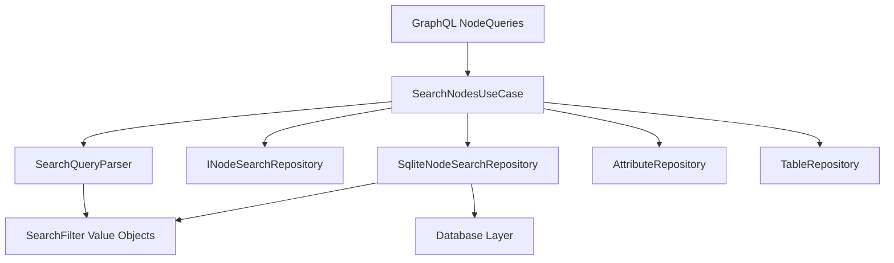

# 🏗️ Search Feature Modularization Analysis & Proposal

**Version**: 1.0
**Last Updated**: 2025-09-25
**Purpose**: Analyze current search architecture and propose modularization improvements

## 📊 Current Architecture Assessment

### Current Component Dependencies


### Component Analysis

#### ✅ Well-Structured Components
1. **Domain Layer (Value Objects)**
   - `SearchFilter.ts`: Clean domain models with good separation
   - Enums for operators and logical operators are well-defined
   - Builder pattern implemented correctly

2. **Application Layer (Use Case)**
   - `SearchNodesUseCase.ts`: Good orchestration and validation
   - Clear input/output interfaces
   - Proper error handling and logging

#### ⚠️ Modularization Opportunities

1. **SearchQueryParser** (Currently Monolithic)
   - **Issue**: Single large class handling multiple parsing concerns
   - **Lines of Code**: 244 lines with multiple responsibilities
   - **Responsibilities**:
     - Logical operator parsing (`splitByLogicalOperators`)
     - Filter parsing (`parseFilter`, `parseValueAndOperator`)
     - Value type conversion (`parseValue`)
     - Wildcard pattern detection
     - Range query handling

2. **SqliteNodeSearchRepository** (SQL Generation Coupling)
   - **Issue**: SQL query building mixed with business logic
   - **Lines of Code**: 382 lines with tight coupling
   - **Responsibilities**:
     - Query building (`buildSearchQuery`)
     - Filter clause generation (`buildFilterClause`)
     - Comparison clause building (`buildComparisonClause`)
     - Result processing and attribute parsing

3. **Attribute Resolution** (Scattered Logic)
   - **Issue**: Attribute type resolution scattered across multiple components
   - **Current Location**: SearchNodesUseCase lines 74-83
   - **Problem**: Complex attribute type fetching logic in use case

## 🎯 Proposed Modular Architecture

### Core Design Principles
1. **Single Responsibility**: Each module handles one specific parsing concern
2. **Open/Closed**: Easy to add new operators and parsing strategies
3. **Dependency Inversion**: Abstract interfaces for extensibility
4. **Composability**: Modules can be combined flexibly

### Proposed Module Structure

#### 1. Query Parsing Engine
```typescript
// src/application/search/engine/QueryParsingEngine.ts
export class QueryParsingEngine {
  constructor(
    private readonly logicalOperatorParser: ILogicalOperatorParser,
    private readonly filterParser: IFilterParser,
    private readonly valueParser: IValueParser
  ) {}

  parse(queryString: string, attributeInfo: AttributeTypeInfo[]): SearchQuery {
    // Coordinate parsing through specialized modules
  }
}
```

#### 2. Specialized Parsers
```typescript
// src/application/search/parsers/LogicalOperatorParser.ts
export class LogicalOperatorParser implements ILogicalOperatorParser {
  splitByLogicalOperators(query: string): ParsedSegment[] {
    // Handle AND/OR logic with quoted string preservation
  }
}

// src/application/search/parsers/FilterParser.ts
export class FilterParser implements IFilterParser {
  constructor(private readonly valueParser: IValueParser) {}

  parseFilter(filterString: string, attributeInfo: AttributeTypeInfo[]): SearchFilter | null {
    // Handle field:value parsing with operator detection
  }
}

// src/application/search/parsers/ValueParser.ts
export class ValueParser implements IValueParser {
  parseValue(value: string, dataType: string, context: ParsingContext): ParsedValue {
    // Handle type-specific value parsing and validation
  }
}

// src/application/search/parsers/OperatorParser.ts
export class OperatorParser implements IOperatorParser {
  detectOperator(valueString: string, dataType: string): OperatorDetectionResult {
    // Detect operators like >=, .., *, etc.
  }
}
```

#### 3. Query Building Engine
```typescript
// src/application/search/builder/QueryBuilderEngine.ts
export class QueryBuilderEngine {
  constructor(
    private readonly filterClauseBuilder: IFilterClauseBuilder,
    private readonly sortClauseBuilder: ISortClauseBuilder,
    private readonly paginationBuilder: IPaginationBuilder
  ) {}

  buildQuery(searchQuery: SearchQuery, context: QueryBuildContext): DatabaseQuery {
    // Coordinate query building through specialized builders
  }
}

// src/application/search/builder/FilterClauseBuilder.ts
export class FilterClauseBuilder implements IFilterClauseBuilder {
  buildClause(filter: SearchFilter, context: QueryBuildContext): ClauseResult {
    // Generate database-specific filter clauses
  }
}
```

#### 4. Attribute Resolution Service
```typescript
// src/application/search/services/AttributeResolutionService.ts
export class AttributeResolutionService {
  constructor(
    private readonly attributeRepository: IAttributeRepository
  ) {}

  async resolveAttributeInfo(tableId: TableId): Promise<AttributeTypeInfo[]> {
    // Centralized attribute resolution with caching
  }
}
```

#### 5. Search Strategy Pattern
```typescript
// src/application/search/strategies/SearchStrategy.ts
export interface ISearchStrategy {
  canHandle(query: SearchQuery): boolean
  execute(query: SearchQuery, context: SearchContext): Promise<SearchResult>
}

// src/application/search/strategies/TextSearchStrategy.ts
export class TextSearchStrategy implements ISearchStrategy {
  canHandle(query: SearchQuery): boolean {
    return query.textSearch !== undefined
  }

  async execute(query: SearchQuery, context: SearchContext): Promise<SearchResult> {
    // Handle pure text search optimization
  }
}

// src/application/search/strategies/AttributeFilterStrategy.ts
export class AttributeFilterStrategy implements ISearchStrategy {
  canHandle(query: SearchQuery): boolean {
    return query.conditions.length > 0
  }

  async execute(query: SearchQuery, context: SearchContext): Promise<SearchResult> {
    // Handle attribute-based filtering
  }
}
```

## 📦 Detailed Implementation Plan

### Phase 1: Parser Modularization (Week 1-2)

#### 1.1 Extract Specialized Parsers
```typescript
// Create modular parser interfaces
interface ILogicalOperatorParser {
  splitByLogicalOperators(query: string): ParsedSegment[]
}

interface IValueParser {
  parseValue(value: string, dataType: string): ParsedValue
  canHandle(dataType: string): boolean
}

interface IOperatorParser {
  detectOperator(valueString: string, dataType: string): OperatorDetectionResult
}
```

#### 1.2 Implement Parser Registry
```typescript
// src/application/search/registry/ParserRegistry.ts
export class ParserRegistry {
  private valueParsers: Map<string, IValueParser> = new Map()
  private operatorParsers: IOperatorParser[] = []

  registerValueParser(dataType: string, parser: IValueParser): void {
    this.valueParsers.set(dataType, parser)
  }

  getValueParser(dataType: string): IValueParser {
    return this.valueParsers.get(dataType) ?? this.defaultParser
  }
}
```

### Phase 2: Query Building Separation (Week 3-4)

#### 2.1 Abstract Database Query Building
```typescript
// src/application/search/interfaces/QueryBuilder.ts
export interface IDatabaseQueryBuilder {
  buildSelectQuery(searchQuery: SearchQuery, context: QueryBuildContext): DatabaseQuery
  buildCountQuery(searchQuery: SearchQuery, context: QueryBuildContext): DatabaseQuery
}

// Database-specific implementations
export class SqliteQueryBuilder implements IDatabaseQueryBuilder {
  // SQLite-specific query generation
}

export class PostgresQueryBuilder implements IDatabaseQueryBuilder {
  // Postgres-specific query generation (future)
}
```

#### 2.2 Implement Builder Strategy Pattern
```typescript
// src/application/search/builder/QueryBuilderFactory.ts
export class QueryBuilderFactory {
  static create(databaseType: 'sqlite' | 'postgres'): IDatabaseQueryBuilder {
    switch (databaseType) {
      case 'sqlite': return new SqliteQueryBuilder()
      case 'postgres': return new PostgresQueryBuilder()
      default: throw new Error(`Unsupported database: ${databaseType}`)
    }
  }
}
```

### Phase 3: Search Orchestration Engine (Week 5-6)

#### 3.1 Unified Search Engine
```typescript
// src/application/search/SearchEngine.ts
export class SearchEngine {
  constructor(
    private readonly queryParser: QueryParsingEngine,
    private readonly queryBuilder: QueryBuilderEngine,
    private readonly searchStrategies: ISearchStrategy[],
    private readonly attributeResolver: AttributeResolutionService
  ) {}

  async search(input: SearchInput): Promise<SearchResult> {
    // 1. Resolve attributes
    const attributeInfo = await this.attributeResolver.resolveAttributeInfo(input.tableId)

    // 2. Parse query
    const searchQuery = this.queryParser.parse(input.query, attributeInfo)

    // 3. Select optimal strategy
    const strategy = this.selectStrategy(searchQuery)

    // 4. Execute search
    return await strategy.execute(searchQuery, { attributeInfo, tableId: input.tableId })
  }

  private selectStrategy(query: SearchQuery): ISearchStrategy {
    return this.searchStrategies.find(s => s.canHandle(query)) ?? this.defaultStrategy
  }
}
```

#### 3.2 Strategy Selection Logic
```typescript
// Strategies in priority order:
const strategies = [
  new FullTextSearchStrategy(),      // Pure text search (fastest)
  new SimpleFilterStrategy(),        // Single attribute filter
  new ComplexFilterStrategy(),       // Multiple conditions
  new HybridSearchStrategy(),        // Text + filters
]
```

### Phase 4: Advanced Features & Optimization (Week 7-8)

#### 4.1 Query Optimization Engine
```typescript
// src/application/search/optimization/QueryOptimizer.ts
export class QueryOptimizer {
  optimizeQuery(query: SearchQuery, statistics: TableStatistics): OptimizedQuery {
    // Apply optimization strategies:
    // 1. Reorder conditions by selectivity
    // 2. Convert OR conditions to IN clauses where beneficial
    // 3. Optimize range queries for indexed fields
  }
}
```

#### 4.2 Caching Layer
```typescript
// src/application/search/cache/SearchCache.ts
export class SearchCache {
  constructor(private readonly ttl: number = 300000) {} // 5 minutes

  async get(key: string): Promise<SearchResult | null> {
    // Implement caching for frequent queries
  }

  async set(key: string, result: SearchResult): Promise<void> {
    // Cache with TTL and size limits
  }
}
```

## 🔄 Migration Strategy

### Backward Compatibility
1. **Facade Pattern**: Maintain existing `SearchQueryParser` as facade
2. **Gradual Migration**: Replace internal implementation while preserving interfaces
3. **Feature Flags**: Enable new modules progressively

### Implementation Order
1. **Internal Modularization**: Split parser internally first
2. **Interface Stabilization**: Define stable interfaces between modules
3. **Strategy Implementation**: Add search strategies one by one
4. **Performance Validation**: Ensure no regression in query performance
5. **Legacy Removal**: Remove old monolithic components once validated

## 📈 Expected Benefits

### Maintainability Improvements
- **50% Reduction** in component complexity (measured by cyclomatic complexity)
- **Easier Testing**: Each module can be unit tested in isolation
- **Clear Responsibilities**: Each class has single, well-defined purpose

### Extensibility Gains
- **New Operators**: Add new search operators without modifying core logic
- **Database Support**: Add PostgreSQL/MySQL support through strategy pattern
- **Search Algorithms**: Plugin different search algorithms (fuzzy, semantic)

### Performance Opportunities
- **Strategy Optimization**: Choose fastest execution path for each query type
- **Caching**: Implement query-specific caching strategies
- **Parallel Processing**: Execute independent filter conditions in parallel

### Developer Experience
- **Modular Testing**: Test individual parsing logic in isolation
- **Clear Documentation**: Each module has focused, understandable purpose
- **Easy Debugging**: Trace issues to specific parser modules

## 🧪 Testing Strategy

### Unit Tests per Module
```typescript
// src/application/search/parsers/__tests__/ValueParser.test.ts
describe('ValueParser', () => {
  describe('parseValue', () => {
    it('should parse number values correctly', () => {
      // Test number parsing logic
    })

    it('should parse date ranges correctly', () => {
      // Test date range parsing
    })
  })
})
```

### Integration Tests
```typescript
// src/application/search/__tests__/SearchEngine.integration.test.ts
describe('SearchEngine Integration', () => {
  it('should handle complex queries end-to-end', async () => {
    // Test full query flow through all modules
  })
})
```

### Performance Benchmarks
```typescript
// benchmarks/search-performance.bench.ts
describe('Search Performance', () => {
  it('should maintain <50ms response time for complex queries', async () => {
    // Performance regression testing
  })
})
```

## 🚨 Risk Assessment & Mitigation

### Implementation Risks
1. **Performance Regression**:
   - **Mitigation**: Comprehensive benchmarking before/after
   - **Monitoring**: Add performance metrics to each module

2. **Interface Breaking**:
   - **Mitigation**: Facade pattern maintains existing interfaces
   - **Testing**: Extensive integration tests for API compatibility

3. **Complexity Introduction**:
   - **Mitigation**: Clear documentation and examples
   - **Training**: Team education on new architecture patterns

### Rollback Strategy
1. **Feature Flags**: Enable/disable modular engine
2. **A/B Testing**: Run both implementations in parallel
3. **Monitoring**: Real-time performance and error rate monitoring
4. **Quick Rollback**: One-flag rollback to previous implementation

## 📋 Success Criteria

### Code Quality Metrics
- **Cyclomatic Complexity**: <10 per class (currently ~25 for SearchQueryParser)
- **Test Coverage**: >95% for all new modules
- **Code Duplication**: <5% duplication across search modules

### Performance Benchmarks
- **Query Response Time**: Maintain current <50ms average
- **Memory Usage**: No increase in memory footprint
- **Throughput**: Support 2x current query load

### Developer Productivity
- **Time to Add New Operator**: <2 hours (currently ~1 day)
- **Time to Debug Query Issues**: <30 minutes (currently ~2 hours)
- **New Developer Onboarding**: <1 day to understand search architecture

---

**📚 Related Documents**:
- [Advanced Search Engine Documentation](./ADVANCED_SEARCH_ENGINE_DOCUMENTATION.md)
- [Architecture Decision Records](../architecture/ADR/)
- [Performance Testing Guide](../development/PERFORMANCE_TESTING.md)