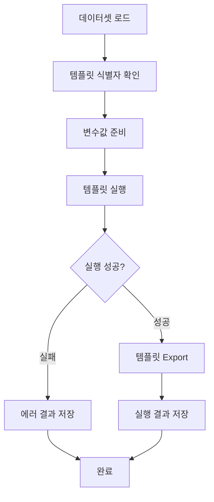

# Demo 폴더 구조 및 관리 가이드

## 📁 폴더 구조

```
demo/
├── 📊 datasets/                    # 템플릿 실행 데이터셋
│   ├── basic/                     # 기본 실행 데이터셋
│   ├── advanced/                  # 고급 실행 데이터셋 (변수 포함)
│   └── edge-cases/                # 에러 케이스 데이터셋
├── 📄 templates/                  # Export된 템플릿 파일들
├── 📈 results/                    # 실행 결과 파일들
├── 🔧 utils/                     # 유틸리티 (GraphQL 클라이언트, 데모 러너)
├── 🏗️ fixtures/                  # 테스트용 고정 데이터
├── 🎯 template-queries/          # 레거시 템플릿 쿼리 (참고용)
├── 🧪 curl-tester.ts             # 메인 테스팅 시스템
└── 📖 README.md                  # 데모 사용법
```

## 🎯 핵심 개념

### 데이터셋 (datasets/)
**목적**: 기존 템플릿을 실행하기 위한 명세서
- 실행할 템플릿의 식별자
- 템플릿에 전달할 변수값
- 예상 결과 및 테스트 설정

### 템플릿 (templates/)
**목적**: 서버에서 export한 완전한 템플릿 백업
- 실제 DB에 저장된 템플릿의 완전한 데이터
- 통계, 메타데이터, 사용 기록 포함
- import/export 기능으로 템플릿 이전

### 결과 (results/)
**목적**: 데이터셋 실행 결과 기록
- 실행 성공/실패 여부
- 실행 시간 및 메타데이터
- 에러 정보 (실패시)
- 데이터셋 정보와 매칭

## 📊 데이터셋 구조

### 기본 데이터셋
```json
{
  "name": "Health Check Dataset",
  "description": "Execute health check using existing template",
  "domain": "system",
  "category": "basic",
  
  "templateExecution": {
    "templateIdentifier": "test-health-check",  // 기존 템플릿 ID
    "variables": null                           // 변수값 (없으면 null)
  },
  
  "expectedResult": {
    "success": true,
    "dataShape": { "health": { "status": "string" } }
  },
  
  "testConfig": {
    "shouldExport": true,                       // 템플릿 export 여부
    "retryOnFailure": false                     // 실패시 재시도 여부
  }
}
```

### 변수가 있는 데이터셋
```json
{
  "templateExecution": {
    "templateIdentifier": "test-search-nodes",
    "variables": {                              // 템플릿에 전달할 변수
      "filter": "",
      "limit": 5
    }
  }
}
```

## 🔄 실행 플로우



## 📂 파일 매칭 규칙

### 템플릿과 결과 매칭
- **템플릿**: `template-name_v1-0-0.json`
- **결과**: `template-name_v1-0-0_result.json`

### 파일명 규칙
- 버전 기반: `v1-0-0` (dots를 hyphens로 대체)
- 타임스탬프 제거
- 의미 있는 템플릿 식별자 사용

## 🚀 사용법

### 단일 데이터셋 테스트
```bash
bun run demo:test-dataset basic/health-check.json
```

### 서버 주소 지정
```bash
SERVER_URL=http://localhost:3000/graphql bun run demo:test-dataset basic/health-check.json
```

### 전체 데이터셋 배치 테스트
```bash
# 모든 basic 데이터셋 테스트
find demo/datasets/basic -name "*.json" | xargs -I {} bun run demo:test-dataset {}
```

## 📁 카테고리별 데이터셋 (총 15개)

### basic/ (6개)
- `health-check.json`: 시스템 상태 확인 (변수 없음) → `test-health-check`
- `list-tables.json`: 테이블 목록 조회 (변수 없음) → `test-list-tables`  
- `search-nodes.json`: 노드 검색 (필터, 리미트 변수) → `test-search-nodes`
- `test-query1.json`: 기본 테스트 쿼리 1 (변수 없음) → `test-testquery1`
- `test-query2.json`: 기본 테스트 쿼리 2 (변수 없음) → `test-testquery2`

### advanced/ (5개)
- `get-node-by-id.json`: ID로 노드 조회 (nodeId 변수) → `test-get-node`
- `get-table-by-id-alt.json`: ID로 테이블 조회 (tableId 변수) → `test-get-table`
- `get-table-by-id.json`: ID로 테이블 조회 (tableId 변수) → `test-get-table`
- `list-tables-with-pagination.json`: 페이지네이션으로 테이블 목록 (first, after 변수) → `test-list-tables`
- `search-nodes-with-table.json`: 테이블별 노드 검색 (tableId, filter 변수) → `test-search-nodes`

### mutations/ (3개)
- `create-node.json`: 노드 생성 (input 변수) → `test-create-node`
- `create-table.json`: 테이블 생성 (input 변수) → `test-create-table`
- `test-mutation1.json`: 기본 테스트 뮤테이션 (변수 없음) → `test-testmutation1`

### edge-cases/ (2개)
- `invalid-query.json`: 존재하지 않는 템플릿 (에러 테스트)
- `malformed-query.json`: 구문 오류 템플릿 (에러 테스트)

## 🔍 결과 분석

### 성공 결과 예시
```json
{
  "execution": { "success": true, "executionTimeMs": 47 },
  "result": { "data": {...}, "error": null },
  "metadata": { "resultType": "success", "dataSize": 712 }
}
```

### 실패 결과 예시
```json
{
  "execution": { "success": false, "executionTimeMs": 42 },
  "result": { "data": null, "error": "Template not found" },
  "metadata": { "resultType": "error", "hasData": false }
}
```

## 🛠️ 관리 도구

### curl-tester.ts
메인 테스팅 시스템:
- 데이터셋 로드 및 검증
- 템플릿 실행 및 결과 검증
- Export 및 결과 파일 생성
- 에러 처리 및 로깅

### 폴더 자동 생성
시스템이 자동으로 필요한 폴더를 생성:
- `demo/templates/` - export된 템플릿 저장
- `demo/results/` - 실행 결과 저장

## 📈 확장 가이드

### 새로운 데이터셋 추가
1. 적절한 카테고리 폴더에 JSON 파일 생성
2. 기존 템플릿의 식별자 확인
3. 필요한 변수 정의
4. 예상 결과 및 테스트 설정 구성

### 새로운 카테고리 추가
1. `demo/datasets/` 아래에 새 폴더 생성
2. 해당 카테고리의 데이터셋들 추가
3. README.md에 카테고리 설명 추가

이 구조는 템플릿과 데이터셋을 명확히 분리하고, 실행 결과를 체계적으로 관리할 수 있게 합니다.