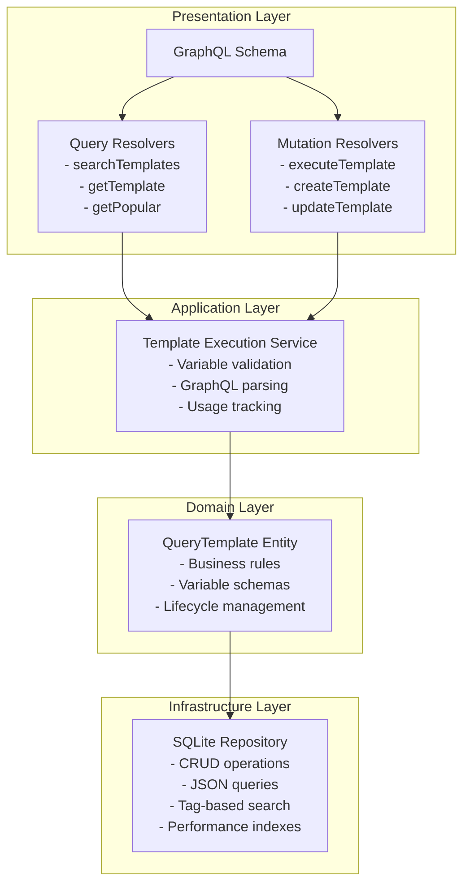

# Template Management Guide

## 📋 Overview

Complete guide for managing GraphQL query templates in the bun-graph-db system. This includes template lifecycle, best practices, and advanced management features.

## 🏗️ System Architecture

The template system follows hexagonal architecture with clean domain boundaries:



### Core Components

1. **QueryTemplate Domain Entity** (`src/domain/entities/QueryTemplate.ts`)
   - Immutable value object with business rules
   - Variable validation and schema management
   - Template applicability and lifecycle methods

2. **IQueryTemplateRepository Interface** (`src/domain/repositories/IQueryTemplateRepository.ts`)
   - Repository contract with search capabilities
   - Advanced filtering by tags, tables, and criteria

3. **SQLiteQueryTemplateRepository** (`src/infrastructure/database/sqlite/SqliteQueryTemplateRepository.ts`)
   - SQL implementation with JSON query support
   - Performance optimized with proper indexing

4. **Template Resolvers** (`src/presentation/graphql/`)
   - GraphQL operations for template management
   - Template execution with variable processing

## 🔄 Template Lifecycle

### 1. Template Creation
```graphql
mutation CreateTemplate {
  createTemplate(input: {
    identifier: "unique-template-id"
    name: "Human Readable Name"
    description: "Clear description of template purpose"
    query: "query TemplateQuery($param: Type!) { ... }"
    variables: { "param": "defaultValue" }
    createdBy: "user-or-system"
  }) {
    template {
      id
      identifier
      name
    }
    errors { message }
  }
}
```

### 2. Template Discovery
```graphql
# Basic Search
query FindTemplates {
  searchTemplates(
    filter: { isActive: true }
    pagination: { limit: 20, offset: 0 }
    sort: [{ field: "usageCount", direction: "DESC" }]
  ) {
    nodes {
      id
      identifier
      name
      description
      usageCount
      isActive
      createdAt
      updatedAt
    }
    totalCount
    hasNextPage
    hasPreviousPage
  }
}

# Advanced Search (Template-based)
mutation AdvancedTemplateSearch {
  executeTemplateWithGraphQL(
    templateIdentifier: "search-templates-advanced"
    variables: {
      filter: { isActive: true, search: "table" }
      pagination: { limit: 10, offset: 0 }
      sort: [{ field: "name", direction: "ASC" }]
    }
  ) {
    success
    data
    errors { message }
  }
}
```

### 3. Template Execution
```graphql
mutation ExecuteTemplate {
  executeTemplateWithGraphQL(
    templateIdentifier: "template-identifier"
    variables: { "customParam": "customValue" }
    trackUsage: true
  ) {
    success
    data
    errors { message }
  }
}
```

### 4. Template Updates
```graphql
mutation UpdateTemplate {
  updateTemplate(
    id: "template-id"
    input: {
      name: "Updated Name"
      description: "Updated description"
      isActive: true
    }
  ) {
    template {
      id
      name
      updatedAt
    }
    errors { message }
  }
}
```

### 5. Template Deletion
```graphql
# Direct Deletion
mutation DeleteTemplate {
  deleteTemplate(id: "template-id") {
    success
    errors { message }
  }
}

# Template-based Deletion
mutation DeleteTemplateById {
  executeTemplateWithGraphQL(
    templateIdentifier: "delete-template-by-id"
    variables: { "templateId": "123" }
  ) {
    success
    data
    errors { message }
  }
}
```

## 📊 Template Analytics and Monitoring

### Usage Statistics
```graphql
query TemplateStats {
  template(id: "template-id") {
    id
    identifier
    name
    usageCount
    lastUsedAt
    avgExecutionTimeMs
    complexityScore
    isActive
    createdAt
    updatedAt
  }
}
```

### Popular Templates
```graphql
query PopularTemplates {
  searchTemplates(
    filter: { isActive: true }
    sort: [{ field: "usageCount", direction: "DESC" }]
    pagination: { limit: 10, offset: 0 }
  ) {
    nodes {
      identifier
      name
      usageCount
      avgExecutionTimeMs
    }
  }
}
```

## 🛠️ Advanced Template Management

### Batch Operations

#### Import Multiple Templates
```typescript
// Example batch import workflow
const templates = [
  { identifier: "template-1", name: "Template 1", query: "..." },
  { identifier: "template-2", name: "Template 2", query: "..." }
];

for (const template of templates) {
  await createTemplate({ input: template });
}
```

#### Export Template Collection
```graphql
query ExportTemplates {
  searchTemplates(
    filter: { isActive: true }
    pagination: { limit: 100, offset: 0 }
  ) {
    nodes {
      identifier
      name
      description
      query
      variables
      operationType
      complexityScore
      tags
      version
      createdAt
      updatedAt
    }
  }
}
```

### Template Validation

#### Pre-execution Validation
```typescript
// Validate template before execution
const validationResult = await validateTemplate({
  query: templateQuery,
  variables: templateVariables
});

if (!validationResult.isValid) {
  console.error('Template validation failed:', validationResult.errors);
  return;
}
```

#### Runtime Validation
- **GraphQL Schema Validation**: Automatic schema compliance checking
- **Variable Type Validation**: Type safety for template variables
- **Query Complexity Analysis**: Automatic complexity scoring
- **Performance Monitoring**: Execution time tracking

## 🔍 Template Discovery Patterns

### By Category
```graphql
# Search by tags
mutation SearchByCategory {
  executeTemplateWithGraphQL(
    templateIdentifier: "search-templates-advanced"
    variables: {
      filter: { tags: ["table", "creation"] }
    }
  ) {
    success
    data
  }
}
```

### By Performance
```graphql
# Find fast-executing templates
mutation FindFastTemplates {
  executeTemplateWithGraphQL(
    templateIdentifier: "search-templates-advanced"
    variables: {
      sort: [{ field: "avgExecutionTimeMs", direction: "ASC" }]
      pagination: { limit: 10 }
    }
  ) {
    success
    data
  }
}
```

### By Recent Activity
```graphql
# Recently used templates
mutation RecentTemplates {
  executeTemplateWithGraphQL(
    templateIdentifier: "search-templates-advanced"
    variables: {
      sort: [{ field: "updatedAt", direction: "DESC" }]
      pagination: { limit: 5 }
    }
  ) {
    success
    data
  }
}
```

## 🎯 Best Practices

### Template Design
1. **Clear Naming**: Use descriptive identifiers and names
2. **Comprehensive Descriptions**: Explain template purpose and usage
3. **Default Variables**: Provide sensible defaults for all parameters
4. **Query Optimization**: Write efficient GraphQL queries
5. **Error Handling**: Include proper error response handling

### Template Organization
1. **Consistent Identifiers**: Use kebab-case naming convention
2. **Categorization**: Use tags for logical grouping
3. **Version Control**: Track template versions for changes
4. **Documentation**: Maintain usage examples and parameter descriptions

### Performance Optimization
1. **Complexity Scoring**: Monitor and optimize high-complexity templates
2. **Usage Tracking**: Identify and optimize frequently used templates
3. **Caching Strategy**: Cache results for static or slow queries
4. **Batch Operations**: Group related operations when possible

### Security Considerations
1. **Input Validation**: Validate all template variables
2. **Access Control**: Implement proper permission checks
3. **Query Limits**: Set reasonable complexity and depth limits
4. **Audit Logging**: Track template creation and modifications

## 🚀 Available Management Templates

### Built-in System Templates

#### Template Search and Discovery
- **Identifier**: `search-templates-advanced`
- **Purpose**: Advanced template search with filtering and sorting
- **Features**: Pagination, multi-field filtering, custom sorting
- **Usage**: Template discovery and management

#### Template Deletion
- **Identifier**: `delete-template-by-id`
- **Purpose**: Safe template deletion by ID
- **Features**: Validation and confirmation
- **Usage**: Template cleanup and removal

### Custom Management Templates
Create specialized management templates for your use cases:

```graphql
# Template for finding templates by creator
mutation CreateCreatorSearchTemplate {
  createTemplate(input: {
    identifier: "search-templates-by-creator"
    name: "Search Templates by Creator"
    description: "Find all templates created by a specific user"
    query: "query SearchByCreator($createdBy: String!) { searchTemplates(filter: { createdBy: $createdBy }) { nodes { id identifier name createdBy createdAt } } }"
    variables: { "createdBy": "system" }
  }) {
    template { id identifier }
  }
}
```

## 📈 Performance Monitoring

### Execution Metrics
- **Response Time**: Average execution time tracking
- **Usage Frequency**: Template usage count and trends
- **Error Rates**: Failed execution monitoring
- **Complexity Analysis**: Query complexity scoring

### Optimization Strategies
1. **Profile Slow Templates**: Identify performance bottlenecks
2. **Optimize Queries**: Improve GraphQL query structure
3. **Cache Results**: Implement caching for static data
4. **Monitor Usage**: Track template adoption and performance

## 🔧 Troubleshooting

### Common Issues

#### Template Not Found
```graphql
# Verify template exists
query CheckTemplate {
  template(id: "template-id") {
    id
    identifier
    isActive
  }
}
```

#### Variable Validation Errors
- Check variable types match schema requirements
- Ensure all required variables are provided
- Validate variable names match template definition

#### Query Execution Failures
- Test GraphQL query independently
- Check schema compatibility
- Verify permissions and access controls

### Debug Templates
```graphql
# Create debug template for troubleshooting
mutation CreateDebugTemplate {
  createTemplate(input: {
    identifier: "debug-template-execution"
    name: "Debug Template Execution"
    description: "Test template execution with minimal query"
    query: "query DebugQuery { __schema { queryType { name } } }"
    variables: {}
  }) {
    template { id }
  }
}
```

## 📚 Additional Resources

- **Template Usage Guide**: Comprehensive usage patterns and examples
- **GraphQL Schema Documentation**: Complete API reference
- **Performance Best Practices**: Optimization guidelines
- **Security Guidelines**: Template security best practices

## 🔄 Version Management

### Template Versioning
- **Version Field**: Track template versions (e.g., "1.0.0")
- **Change Tracking**: Monitor template modifications
- **Rollback Support**: Maintain previous versions for rollback
- **Migration Path**: Upgrade templates with breaking changes

### Version Control Best Practices
1. **Semantic Versioning**: Use meaningful version numbers
2. **Change Documentation**: Document version changes
3. **Backward Compatibility**: Maintain compatibility when possible
4. **Migration Scripts**: Provide upgrade paths for breaking changes

This comprehensive guide covers all aspects of template management, from basic operations to advanced optimization strategies.