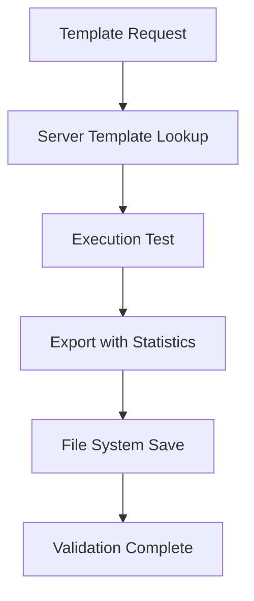
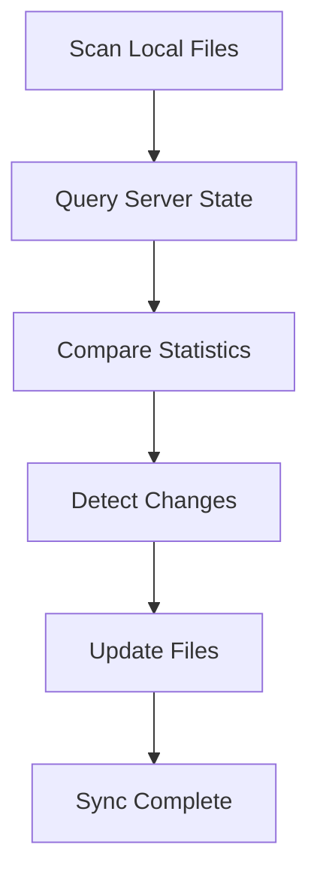

# Template Validation and Synchronization Process Documentation

## 🔄 Overview

본 문서는 bun-graph-db 프로젝트의 템플릿 검증 및 동기화 시스템에 대한 완전한 분석과 프로세스 가이드입니다.

## 📋 시스템 구성 요소

### 1. 검증 시스템 (Validation System)

#### 핵심 스크립트: `scripts/simple-validator.ts`
- **통합 검증 도구**: 검증 + Export 기능 통합
- **실행 경로**: `bun run template:validate-single <template-identifier>`

**검증 프로세스**:
1. **템플릿 조회**: GraphQL을 통해 서버에서 템플릿 정보 조회
2. **실행 테스트**: `executeTemplateWithGraphQL` mutation으로 실제 동작 확인
3. **Export 실행**: `exportTemplate` mutation으로 통계 포함 export
4. **파일 저장**: `demo/templates/` 디렉토리에 JSON 파일 저장

**검증 옵션**:
- `includeStatistics`: 사용 통계 포함 여부 (기본값: true)
- `skipValidation`: 검증 단계 스킵 여부 (기본값: false)
- `outputDir`: 출력 디렉토리 (기본값: `./demo/templates`)

### 2. 동기화 시스템 (Synchronization System)

#### 핵심 스크립트: `scripts/template-sync.ts`
- **양방향 동기화**: 서버 ↔ 파일 시스템 동기화
- **사용 통계 업데이트**: usageCount, avgExecutionTimeMs, lastUsedAt 추적

**동기화 프로세스**:
1. **파일 스캔**: `demo/templates/` 디렉토리의 기존 파일들 스캔
2. **서버 상태 조회**: 각 템플릿의 최신 서버 정보 조회
3. **변경 사항 감지**: 사용 통계 등 변경 사항 확인
4. **파일 업데이트**: 변경된 템플릿 파일 업데이트

## 🛠️ 사용 가능한 명령어들

### Package.json 스크립트
```bash
# 단일 템플릿 검증 및 Export
bun run template:validate-single <template-identifier>

# 서버 상태 확인
bun run template:check-server

# 백업 생성
bun run template:backup

# 복원 가이드
bun run template:restore
```

### 동기화 스크립트 (직접 실행)
```bash
# 전체 템플릿 동기화
bun scripts/template-sync.ts

# 특정 템플릿 동기화
bun scripts/template-sync.ts <template-identifier>
```

## 📊 데이터 흐름

### 1. 검증 및 Export 흐름


### 2. 동기화 흐름


## 🔧 스펙 변경 대응 프로세스

### 현재 상황: create-attribute-with-type 템플릿 수정 필요
- **문제**: 속성 조회 키가 `nodes`인데 `attributes`가 더 적합
- **해결 프로세스**:

#### 1. 서버에서 템플릿 스펙 변경
```bash
# GraphQL mutation으로 템플릿 쿼리 수정
curl -X POST http://localhost:4000/graphql \
  -H "Content-Type: application/json" \
  -d '{
    "query": "mutation UpdateTemplate($identifier: String!, $input: UpdateQueryTemplateInput!) { updateTemplate(templateIdentifier: $identifier, input: $input) { success template { id identifier } errors { message } } }",
    "variables": {
      "identifier": "create-attribute-with-type",
      "input": {
        "query": "# Updated query with attributes instead of nodes"
      }
    }
  }'
```

#### 2. 검증 및 Export
```bash
bun run template:validate-single create-attribute-with-type
```

#### 3. 전체 동기화 (필요시)
```bash
bun scripts/template-sync.ts
```

## 🚨 주의사항

### 안전 장치들
1. **백업 자동 생성**: 중요한 변경 전 자동 백업
2. **실행 테스트**: 실제 GraphQL 실행으로 검증
3. **점진적 동기화**: 템플릿별 개별 처리
4. **에러 복구**: 실패 시 이전 상태로 복원 가능

### Best Practices
1. **변경 전 백업**: `bun run template:backup`
2. **단일 템플릿 테스트**: 전체 동기화 전 개별 검증
3. **서버 상태 확인**: `bun run template:check-server`로 사전 확인
4. **점진적 적용**: 한 번에 하나씩 변경

## 📋 체크리스트

### 스펙 변경 시
- [ ] 백업 생성
- [ ] 서버 상태 확인
- [ ] 템플릿 스펙 수정
- [ ] 개별 템플릿 검증
- [ ] 전체 동기화 실행
- [ ] 결과 확인 및 커밋

### 정기 동기화 시
- [ ] 서버 상태 확인
- [ ] 동기화 스크립트 실행
- [ ] 변경 사항 확인
- [ ] 파일 시스템 정합성 확인

## 🔗 관련 파일들

- `scripts/simple-validator.ts` - 통합 검증 도구
- `scripts/template-sync.ts` - 동기화 도구
- `demo/templates/` - Export된 템플릿 파일들
- `docs/TEMPLATE_MANAGEMENT_PRACTICAL_GUIDE.md` - 실무 가이드
- `package.json` - 스크립트 명령어들

이 시스템을 통해 템플릿 스펙 변경과 전체 동기화를 안전하고 체계적으로 관리할 수 있습니다.