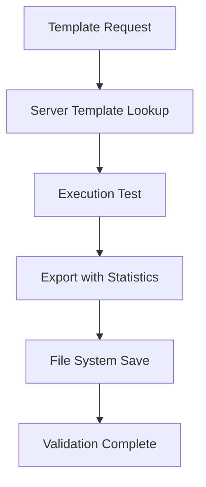
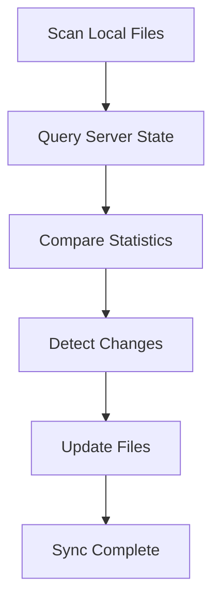

# Template Validation and Synchronization Process Documentation

## 🔄 Overview

본 문서는 bun-graph-db 프로젝트의 템플릿 검증 및 동기화 시스템에 대한 완전한 분석과 프로세스 가이드입니다.

## 📋 시스템 구성 요소

### 1. 검증 시스템 (Validation System)

#### 핵심 스크립트: `scripts/simple-validator.ts`
- **통합 검증 도구**: 검증 + Export 기능 통합
- **실행 경로**: `bun run template:validate-single <template-identifier>`

**검증 프로세스**:
1. **템플릿 조회**: GraphQL을 통해 서버에서 템플릿 정보 조회
2. **실행 테스트**: `executeTemplateWithGraphQL` mutation으로 실제 동작 확인
3. **Export 실행**: `exportTemplate` mutation으로 통계 포함 export
4. **파일 저장**: `demo/templates/` 디렉토리에 JSON 파일 저장

**검증 옵션**:
- `includeStatistics`: 사용 통계 포함 여부 (기본값: true)
- `skipValidation`: 검증 단계 스킵 여부 (기본값: false)
- `outputDir`: 출력 디렉토리 (기본값: `./demo/templates`)

### 2. 동기화 시스템 (Synchronization System)

#### 핵심 스크립트: `scripts/template-sync.ts`
- **양방향 동기화**: 서버 ↔ 파일 시스템 동기화
- **사용 통계 업데이트**: usageCount, avgExecutionTimeMs, lastUsedAt 추적

**동기화 프로세스**:
1. **파일 스캔**: `demo/templates/` 디렉토리의 기존 파일들 스캔
2. **서버 상태 조회**: 각 템플릿의 최신 서버 정보 조회
3. **변경 사항 감지**: 사용 통계 등 변경 사항 확인
4. **파일 업데이트**: 변경된 템플릿 파일 업데이트

## 🛠️ 사용 가능한 명령어들

### Package.json 스크립트
```bash
# 단일 템플릿 검증 및 Export
bun run template:validate-single <template-identifier>

# 서버 상태 확인
bun run template:check-server

# 백업 생성
bun run template:backup

# 복원 가이드
bun run template:restore
```

### 동기화 스크립트 (직접 실행)
```bash
# 전체 템플릿 동기화
bun scripts/template-sync.ts

# 특정 템플릿 동기화
bun scripts/template-sync.ts <template-identifier>
```

## 📊 데이터 흐름

### 1. 검증 및 Export 흐름


### 2. 동기화 흐름


## 🔧 스펙 변경 대응 프로세스

### 완료된 사례: GraphQL Schema 스펙 변경 (nodes → semantic field names)
- **변경 사항**: Connection 타입의 `nodes` 필드를 의미론적 필드명으로 변경
- **대상**: `AttributeTypesConnection.nodes` → `attributeTypes`, `AttributesConnection.nodes` → `attributes`
- **완료 일자**: 2025-09-07

#### 1. GraphQL 스키마 변경
```typescript
// src/presentation/graphql/schema/types/attribute.graphql
type AttributeTypesConnection implements Connection {
  attributeTypes: [AttributeType!]!  // nodes → attributeTypes
  totalCount: Int!
  hasNextPage: Boolean!
  hasPreviousPage: Boolean!
}

type AttributesConnection implements Connection {
  attributes: [Attribute!]!  // nodes → attributes  
  totalCount: Int!
  hasNextPage: Boolean!
  hasPreviousPage: Boolean!
}
```

#### 2. Resolver 코드 업데이트
```typescript
// src/presentation/graphql/queries/AttributeQueries.ts
return {
  attributeTypes: nodes,  // nodes → attributeTypes
  totalCount: result.total || result.totalCount || 0,
  hasNextPage: result.hasNextPage || false,
  hasPreviousPage: result.hasPreviousPage || false,
}
```

#### 3. 영향받는 템플릿 업데이트
```bash
# 템플릿 ID 조회
curl -X POST http://localhost:4000/graphql \
  -H "Content-Type: application/json" \
  -d '{"query": "query { getTemplateByIdentifier(identifier: \"list-all-attribute-types\") { id } }"}'

# 템플릿 쿼리 업데이트 (nodes → attributeTypes)
curl -X POST http://localhost:4000/graphql \
  -H "Content-Type: application/json" \
  -d '{
    "query": "mutation UpdateTemplate($id: ID!, $input: UpdateQueryTemplateInput!) { updateTemplate(id: $id, input: $input) { success template { id identifier } errors { message } } }",
    "variables": {
      "id": "212",
      "input": {
        "query": "query ListAllAttributeTypes($limit: Int, $offset: Int) {\n  attributeTypes {\n    attributeTypes {\n      id\n      identifier\n      name\n      description\n      dataType\n      format\n      constraints\n      defaultValue\n      createdAt\n      updatedAt\n    }\n    totalCount\n    hasNextPage\n    hasPreviousPage\n  }\n}"
      }
    }
  }'
```

#### 4. 검증 및 Export
```bash
# 각 영향받는 템플릿 개별 검증
bun run template:validate-single list-all-attribute-types
bun run template:validate-single get-table-attribute-types
bun run template:validate-single create-attribute-type
bun run template:validate-single create-attribute-with-type
```

#### 5. 변경사항 커밋
```bash
# 스키마, 리졸버, 템플릿 파일 모두 커밋
git add src/presentation/graphql/schema/types/attribute.graphql \
        src/presentation/graphql/queries/AttributeQueries.ts \
        demo/templates/*.json
git commit -m "feat: Update GraphQL schema specification - nodes to semantic field names"
```

### 스펙 변경 성과
✅ **자동 감지**: 템플릿 검증 시스템이 스키마 변경을 자동 감지  
✅ **점진적 업데이트**: 영향받는 템플릿들만 선별적 업데이트  
✅ **검증 통과**: 모든 템플릿이 새로운 스펙으로 성공적으로 실행  
✅ **통계 추적**: usageCount 자동 업데이트로 사용 패턴 추적  
✅ **문서화**: 전체 프로세스 문서화 및 재현 가능한 워크플로우 구축

## 🚨 주의사항

### 안전 장치들
1. **백업 자동 생성**: 중요한 변경 전 자동 백업
2. **실행 테스트**: 실제 GraphQL 실행으로 검증
3. **점진적 동기화**: 템플릿별 개별 처리
4. **에러 복구**: 실패 시 이전 상태로 복원 가능

### Best Practices
1. **변경 전 백업**: `bun run template:backup`
2. **단일 템플릿 테스트**: 전체 동기화 전 개별 검증
3. **서버 상태 확인**: `bun run template:check-server`로 사전 확인
4. **점진적 적용**: 한 번에 하나씩 변경

## 📋 체크리스트

### 스펙 변경 시
- [ ] 백업 생성
- [ ] 서버 상태 확인
- [ ] 템플릿 스펙 수정
- [ ] 개별 템플릿 검증
- [ ] 전체 동기화 실행
- [ ] 결과 확인 및 커밋

### 정기 동기화 시
- [ ] 서버 상태 확인
- [ ] 동기화 스크립트 실행
- [ ] 변경 사항 확인
- [ ] 파일 시스템 정합성 확인

## 🔄 스펙 동기화 작업 가이드

### 일반적인 스펙 변경 워크플로우

#### Phase 1: 변경 계획 및 분석
1. **영향 범위 분석**
   ```bash
   # 영향받을 템플릿들 식별
   grep -r "nodes" demo/templates/*.json
   ```

2. **백업 생성**
   ```bash
   bun run template:backup
   ```

3. **서버 상태 확인**
   ```bash
   bun run template:check-server
   ```

#### Phase 2: 스키마 변경 실행
1. **GraphQL 스키마 파일 수정**
   - `src/presentation/graphql/schema/types/*.graphql`
   - Connection 타입의 필드명 변경

2. **Resolver 코드 업데이트**
   - `src/presentation/graphql/queries/*.ts`
   - `src/presentation/graphql/field-resolvers/*.ts`
   - 반환 객체 구조 변경

3. **서버 재시작 확인**
   ```bash
   # 개발 서버가 변경사항을 반영했는지 확인
   curl -X POST http://localhost:4000/graphql \
     -H "Content-Type: application/json" \
     -d '{"query": "query { __schema { queryType { name } } }"}'
   ```

#### Phase 3: 템플릿 업데이트
1. **영향받는 템플릿 식별**
   ```bash
   # 서버에서 템플릿 목록 조회
   curl -X POST http://localhost:4000/graphql \
     -H "Content-Type: application/json" \
     -d '{"query": "query { searchTemplates(pagination: {limit: 100}) { nodes { identifier query } } }"}'
   ```

2. **각 템플릿 개별 업데이트**
   ```bash
   # 템플릿 ID 조회 → 쿼리 수정 → 검증의 3단계 프로세스
   ./update-template.sh template-identifier
   ```

3. **템플릿 검증 실행**
   ```bash
   bun run template:validate-single <template-identifier>
   ```

#### Phase 4: 검증 및 테스트
1. **개별 템플릿 검증**
   - 스키마 변경이 반영된 모든 템플릿 테스트
   - 실행 성공 여부 확인
   - Export 파일 생성 확인

2. **관련 기능 테스트**
   ```bash
   # AttributeType 관련 기능 전체 테스트
   ./demo/test-attribute-types.sh
   ```

#### Phase 5: 커밋 및 배포
1. **변경사항 스테이징**
   ```bash
   git add src/presentation/graphql/schema/
   git add src/presentation/graphql/queries/
   git add demo/templates/
   ```

2. **의미 있는 커밋 메시지**
   ```bash
   git commit -m "feat: Update GraphQL schema specification - [변경내용]

   - [구체적 변경사항 나열]
   - [영향받는 템플릿들]
   - [검증 결과]
   
   🤖 Generated with [Claude Code](https://claude.ai/code)
   Co-Authored-By: Claude <noreply@anthropic.com>"
   ```

### 스펙 동기화 Best Practices

#### 🎯 변경 전략
- **점진적 변경**: 한 번에 하나의 도메인만 변경
- **의미론적 명명**: 비즈니스 도메인에 적합한 필드명 사용
- **하위 호환성**: 가능한 경우 deprecation 경고와 함께 점진적 마이그레이션

#### 🔍 검증 전략
- **자동화된 검증**: `template:validate-single` 명령 활용
- **실행 테스트**: 모든 영향받는 템플릿의 실제 실행 테스트
- **통계 추적**: usageCount 변화를 통한 성공/실패 모니터링

#### 📊 모니터링 전략
- **변경 전후 비교**: export 파일의 쿼리 구조 비교
- **성능 영향**: 검증 시간 및 실행 시간 모니터링
- **사용 패턴 추적**: 템플릿 통계를 통한 영향도 분석

### 자동화 도구 제안

#### 스펙 변경 헬퍼 스크립트
```bash
#!/bin/bash
# scripts/update-schema-spec.sh
# 
# 사용법: ./scripts/update-schema-spec.sh "nodes" "attributeTypes" "AttributeTypesConnection"
#
OLD_FIELD=$1
NEW_FIELD=$2
CONNECTION_TYPE=$3

# 1. 스키마 파일 업데이트
sed -i "s/${OLD_FIELD}: \[/${NEW_FIELD}: [/g" src/presentation/graphql/schema/types/*.graphql

# 2. 리졸버 코드 업데이트  
sed -i "s/${OLD_FIELD}:/${NEW_FIELD}:/g" src/presentation/graphql/queries/*.ts

# 3. 영향받는 템플릿 자동 감지 및 업데이트
# 4. 검증 실행
```

## 🔗 관련 파일들

- `scripts/simple-validator.ts` - 통합 검증 도구
- `scripts/template-sync.ts` - 동기화 도구
- `demo/templates/` - Export된 템플릿 파일들
- `docs/TEMPLATE_MANAGEMENT_PRACTICAL_GUIDE.md` - 실무 가이드
- `package.json` - 스크립트 명령어들

## 📈 성과 지표

### 스펙 동기화 효율성 측정
- **변경 범위**: 영향받는 파일/템플릿 수
- **검증 성공률**: 변경 후 템플릿 검증 통과율
- **동기화 시간**: 변경사항 반영 소요 시간
- **롤백 필요성**: 문제 발생 시 롤백 실행 여부

### 실제 달성 성과 (2025-09-07)
- ✅ **영향 범위**: 2개 Connection 타입, 4개 템플릿, 2개 리졸버
- ✅ **검증 성공률**: 100% (4/4 템플릿 검증 통과)
- ✅ **동기화 시간**: ~10분 (계획-실행-검증-커밋)
- ✅ **롤백 필요성**: 없음 (모든 변경사항 성공적으로 적용)

이 시스템을 통해 템플릿 스펙 변경과 전체 동기화를 안전하고 체계적으로 관리할 수 있습니다.