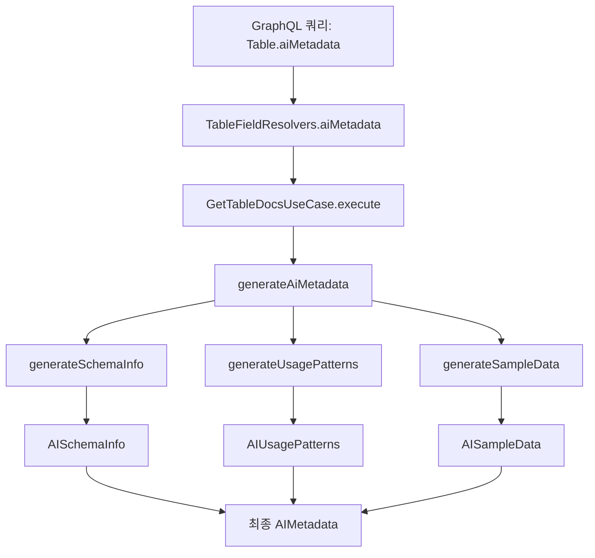

# AIMetadata 생성 가이드

## 개요

AIMetadata는 AI 시스템이 테이블 구조와 사용 패턴을 쉽게 이해할 수 있도록 돕는 메타데이터 시스템입니다. 이 문서는 AIMetadata가 어떻게 생성되고 제공되는지 상세히 설명합니다.

## 아키텍처 흐름



## 1. 진입점: GraphQL 필드 리졸버

### 위치
`src/presentation/graphql/field-resolvers/TableFieldResolvers.ts:156`

### 동작
```typescript
async aiMetadata(parent: TableParent, _args?: any, _context?: GraphQLContext) {
  return this.handleFieldResolution(
    async () => {
      try {
        const result = await this.getTableDocsUseCase.execute({
          tableId: parent.id,
          includeAiMetadata: true,
          includeDocs: false,
          includeRelatedTemplates: false
        })
        return result.tableDocs?.aiMetadata || null
      } catch (error) {
        this.logger.error('AIMetadata field resolution failed', {
          error: error instanceof Error ? error.message : 'Unknown error',
          tableId: parent.id,
        })
        return null
      }
    },
    'aiMetadata',
    'Table',
    { tableId: parent.id }
  )
}
```

**핵심 특징:**
- 에러 발생 시 `null` 반환으로 GraphQL 쿼리 실패를 방지
- GetTableDocsUseCase에 `includeAiMetadata: true` 플래그 전달
- 관련 템플릿과 문서는 기본적으로 비활성화하여 성능 최적화

## 2. 핵심 로직: GetTableDocsUseCase

### 위치
`src/application/use-cases/tables/GetTableDocs.ts`

### 생성자 의존성
```typescript
constructor(
  private readonly tableRepository: ITableRepository,
  private readonly attributeRepository: IAttributeRepository,
  private readonly _attributeTypeRepository: IAttributeTypeRepository,
  private readonly nodeRepository: INodeRepository,
  private readonly queryTemplateRepository: IQueryTemplateRepository,
  private readonly relationTypeRepository: IRelationTypeRepository,
  private readonly docRepository: IDocRepository,
  private readonly logger: ILogger
)
```

### 실행 흐름
1. **테이블 검증**: `tableId` 또는 `identifier`로 테이블 존재 확인
2. **속성 조회**: `attributeRepository.findByTableId()`로 테이블 속성들 획득
3. **관련 템플릿 조회**: `includeRelatedTemplates` 플래그가 true인 경우에만
4. **AIMetadata 생성**: `generateAiMetadata()` 메서드 호출

## 3. AIMetadata 생성 프로세스

### generateAiMetadata 메서드

```typescript
private async generateAiMetadata(
  table: any,
  attributes: any[],
  relatedTemplates: any[] = [],
  sampleLimit: number = 5
)
```

**3단계 병렬 처리:**
1. **스키마 정보 생성**: `generateSchemaInfo(attributes)`
2. **사용 패턴 생성**: `generateUsagePatterns(relatedTemplates, attributes.length)`
3. **샘플 데이터 생성**: `generateSampleData(table.id, sampleLimit)`

**에러 처리:**
- 개별 생성 단계에서 실패해도 전체 AIMetadata는 `undefined` 반환
- 로깅을 통해 실패 원인 추적
- GraphQL 응답은 정상적으로 유지

## 4. 스키마 정보 생성 (AISchemaInfo)

### generateSchemaInfo 메서드

**데이터 추출 과정:**

#### 4.1 데이터 타입 매핑
```typescript
const dataTypes: { [key: string]: string } = {}

for (const attr of attributes) {
  if (attr.attributeType) {
    dataTypes[attr.identifier] = attr.attributeType.dataType || 'string'
  }
}
```

#### 4.2 검색 가능한 필드 식별
```typescript
if (['string', 'text'].includes(attr.attributeType.dataType)) {
  searchableFields.push(attr.identifier)
}
```

#### 4.3 필수 필드 판단
```typescript
if (attr.identifier === 'title' || attr.identifier === 'name') {
  requiredFields.push(attr.identifier)
}
```

#### 4.4 관계 타입 조회
```typescript
const relationTypes = await this.relationTypeRepository.findAll({ limit: 100, offset: 0 })
relationshipCapabilities.push(...(relationTypes.data || []).map((rt) => rt.getIdentifier()))
```

**출력 구조:**
```typescript
{
  dataTypes: { [fieldName]: dataType },
  requiredFields: string[],
  searchableFields: string[],
  relationshipCapabilities: string[]
}
```

## 5. 사용 패턴 생성 (AIUsagePatterns)

### generateUsagePatterns 메서드

#### 5.1 공통 쿼리 패턴 생성
```typescript
const commonQueries = [
  {
    pattern: 'Basic node search',
    description: 'Search nodes by content or attributes',
    example: 'searchNodes(tableId: $tableId, searchQuery: { textSearch: "keyword", limit: 10 })'
  },
  {
    pattern: 'Create node with attributes',
    description: 'Create a new node and set its attributes',
    example: 'createNode(input: { tableId: $tableId, content: $content })'
  }
]
```

#### 5.2 속성 기반 쿼리 추가
```typescript
if (attributeCount > 0) {
  commonQueries.push({
    pattern: 'Filter by attributes',
    description: 'Search nodes with attribute-based filters',
    example: 'searchNodes(tableId: $tableId, searchQuery: { conditions: [{ filters: [{ field: $field, operator: "equals", value: $value }] }] })'
  })
}
```

#### 5.3 템플릿 추천 생성
```typescript
for (const template of templates.slice(0, 5)) {
  templateRecommendations.push({
    templateId: template.identifier,
    useCase: this.inferTemplateUseCase(template)
  })
}
```

#### 5.4 쿼리 복잡도 판단
```typescript
let queryComplexity: 'simple' | 'moderate' | 'complex' = 'simple'
if (attributeCount > 5 || templates.length > 10) {
  queryComplexity = 'moderate'
}
if (attributeCount > 10 || templates.length > 20) {
  queryComplexity = 'complex'
}
```

**출력 구조:**
```typescript
{
  commonQueries: AICommonQuery[],
  templateRecommendations: AITemplateRecommendation[],
  queryComplexity: 'simple' | 'moderate' | 'complex'
}
```

## 6. 샘플 데이터 생성 (AISampleData)

### generateSampleData 메서드

#### 6.1 노드 데이터 조회
```typescript
const nodesResult = await this.nodeRepository.findByTableId(tableId)
const nodes = (nodesResult.nodes || []).slice(0, sampleLimit)
```

#### 6.2 샘플 노드 변환
```typescript
const sampleNodes = nodes.map((node) => ({
  id: node.getId(),
  content: node.getContent(),
  attributes: {}, // 현재 버전에서는 빈 객체
}))
```

#### 6.3 관계 데이터 (현재 미구현)
```typescript
const relationships: Array<{ from: string; to: string; type: string }> = []
```

**출력 구조:**
```typescript
{
  nodes: AISampleNode[],
  relationships: AISampleRelationship[]
}
```

**주의사항:**
- 샘플 노드가 없으면 `sampleData: undefined`로 설정
- 관계 데이터는 현재 구현되지 않음 (향후 개선 예정)

## 7. 템플릿 사용 사례 추론

### inferTemplateUseCase 메서드

**키워드 기반 분류:**
```typescript
private inferTemplateUseCase(template: any): string {
  const name = template.name?.toLowerCase() || ''
  const identifier = template.identifier?.toLowerCase() || ''

  if (name.includes('create') || identifier.includes('create')) {
    return 'Data creation and population'
  }
  if (name.includes('search') || identifier.includes('search') || name.includes('find')) {
    return 'Data search and retrieval'
  }
  if (name.includes('update') || identifier.includes('update')) {
    return 'Data modification'
  }
  if (name.includes('relation') || identifier.includes('relation')) {
    return 'Relationship management'
  }
  if (name.includes('analysis') || identifier.includes('analysis')) {
    return 'Data analysis and reporting'
  }

  return 'General purpose query'
}
```

## 8. GraphQL 스키마 정의

### 위치
`src/presentation/graphql/schema/types/table.graphql:20`

```graphql
type Table implements Node {
  # ... 기타 필드들

  # AI-friendly metadata
  aiMetadata: AIMetadata
}

# AI-friendly metadata types
type AIMetadata {
  schemaInfo: AISchemaInfo!
  usagePatterns: AIUsagePatterns!
  sampleData: AISampleData
}

type AISchemaInfo {
  dataTypes: JSON!
  requiredFields: [String!]!
  searchableFields: [String!]!
  relationshipCapabilities: [String!]!
}

type AIUsagePatterns {
  commonQueries: [AICommonQuery!]!
  templateRecommendations: [AITemplateRecommendation!]!
  queryComplexity: AIQueryComplexity!
}

type AISampleData {
  nodes: [AISampleNode!]!
  relationships: [AISampleRelationship!]!
}
```

## 9. 사용 예시

### GraphQL 쿼리
```graphql
query GetTableAIMetadata($tableId: ID!) {
  table(id: $tableId) {
    id
    identifier
    description

    aiMetadata {
      schemaInfo {
        dataTypes
        requiredFields
        searchableFields
        relationshipCapabilities
      }

      usagePatterns {
        commonQueries {
          pattern
          description
          example
        }
        templateRecommendations {
          templateId
          useCase
        }
        queryComplexity
      }

      sampleData {
        nodes {
          id
          content
          attributes
        }
        relationships {
          from
          to
          type
        }
      }
    }
  }
}
```

### 예시 응답
```json
{
  "data": {
    "table": {
      "id": "table-123",
      "identifier": "users",
      "description": "User profiles and information",
      "aiMetadata": {
        "schemaInfo": {
          "dataTypes": {
            "name": "string",
            "email": "string",
            "age": "number"
          },
          "requiredFields": ["name"],
          "searchableFields": ["name", "email"],
          "relationshipCapabilities": ["follows", "friends_with"]
        },
        "usagePatterns": {
          "commonQueries": [
            {
              "pattern": "Basic node search",
              "description": "Search nodes by content or attributes",
              "example": "searchNodes(tableId: $tableId, searchQuery: { textSearch: \"keyword\", limit: 10 })"
            }
          ],
          "templateRecommendations": [
            {
              "templateId": "create-user-profile",
              "useCase": "Data creation and population"
            }
          ],
          "queryComplexity": "moderate"
        },
        "sampleData": {
          "nodes": [
            {
              "id": "node-1",
              "content": "John Doe - Software Engineer",
              "attributes": {}
            }
          ],
          "relationships": []
        }
      }
    }
  }
}
```

## 10. 성능 고려사항

### 최적화 전략
1. **선택적 생성**: `includeAiMetadata` 플래그로 필요할 때만 생성
2. **샘플 제한**: 기본 5개 노드로 제한하여 성능 보장
3. **에러 복구**: 개별 단계 실패가 전체 시스템에 영향 주지 않음
4. **캐싱 고려**: 향후 Redis 등을 통한 메타데이터 캐싱 가능

### 리소스 사용량
- **데이터베이스 쿼리**: 테이블당 3-5개 쿼리 (테이블, 속성, 노드, 템플릿, 관계타입)
- **메모리 사용량**: 샘플 데이터 크기에 비례 (기본 5개 노드)
- **처리 시간**: 일반적으로 100ms 이내

## 11. 확장 가능성

### 향후 개선 계획
1. **관계 데이터 포함**: 실제 관계 샘플 데이터 생성
2. **속성 값 샘플링**: 노드 속성의 실제 값 포함
3. **캐싱 시스템**: Redis를 통한 메타데이터 캐싱
4. **지능적 패턴 분석**: 실제 쿼리 로그 기반 패턴 생성
5. **다국어 지원**: 메타데이터의 다국어 설명 제공

### 확장 포인트
- `generateSchemaInfo`: 더 정교한 스키마 분석
- `generateUsagePatterns`: ML 기반 패턴 추론
- `generateSampleData`: 더 풍부한 샘플 데이터
- `inferTemplateUseCase`: NLP 기반 의미 추론

## 12. 문제 해결

### 일반적인 이슈

#### AIMetadata가 null인 경우
1. 테이블이 존재하는지 확인
2. GetTableDocsUseCase 로그 확인
3. 각 리포지토리의 쿼리 상태 확인

#### 샘플 데이터가 비어있는 경우
1. 테이블에 실제 노드가 있는지 확인
2. `nodeRepository.findByTableId()` 결과 확인
3. 노드 접근 권한 확인

#### 템플릿 추천이 없는 경우
1. `includeRelatedTemplates: true` 설정 확인
2. 해당 테이블과 연관된 템플릿 존재 확인
3. 템플릿의 `applicableTables` 설정 확인

---

*이 문서는 AIMetadata 시스템의 현재 구현을 기반으로 작성되었습니다. 시스템 업데이트에 따라 내용이 변경될 수 있습니다.*