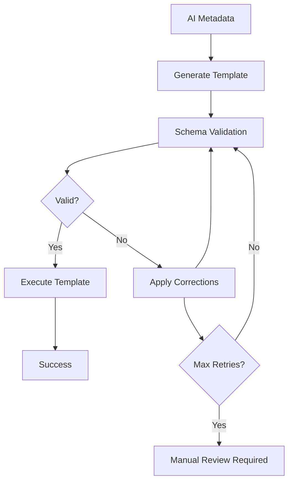

# AI Metadata Template Creation Analysis

**Date**: 2025-01-19
**Project**: Bun Graph DB MCP Table Implementation
**Focus**: AI Metadata Utility for Template Generation

## 🎯 Executive Summary

Analysis of AI metadata effectiveness for automated template creation in the Bun Graph DB MCP system. Findings show **partial utility** with significant schema alignment challenges requiring additional validation processes.

## 📊 Test Methodology

### Test Environment
- **Table**: 265 (test-table-validation)
- **Attributes**: 4 created attributes (name, email, age, phone)
- **MCP Endpoint**: `http://localhost:4141/sub/265/mcp`
- **Template System**: ExecuteTemplateWithGraphQL engine

### Test Process
1. **AI Metadata Analysis**: Retrieved table metadata via `get-table-metadata-265`
2. **Template Generation**: Created template based on AI suggestions
3. **Schema Validation**: Compared AI patterns with actual GraphQL schema
4. **Execution Testing**: Verified template functionality

## 🔍 AI Metadata Content Analysis

### Current AI Metadata Structure
```json
{
  "schemaInfo": {
    "dataTypes": {},
    "requiredFields": [],
    "searchableFields": [],
    "relationshipCapabilities": []
  },
  "usagePatterns": {
    "commonQueries": [
      {
        "pattern": "Basic node search",
        "description": "Search nodes by content or attributes",
        "example": "searchNodes(tableId: $tableId, searchQuery: { textSearch: \"keyword\", limit: 10 })"
      },
      {
        "pattern": "Filter by attributes",
        "description": "Search nodes with attribute-based filters",
        "example": "searchNodes(tableId: $tableId, searchQuery: { conditions: [{ filters: [{ field: $field, operator: \"equals\", value: $value }] }] })"
      }
    ],
    "queryComplexity": "simple"
  }
}
```

### AI Suggestions vs Reality

| Component | AI Metadata Suggestion | Actual GraphQL Schema | Status |
|-----------|------------------------|----------------------|---------|
| **Query Structure** | `searchQuery: { conditions: [...] }` | `filter: SearchNodesFilter!` | ❌ Incompatible |
| **Parameters** | `tableId`, `searchQuery` | `filter`, `pagination`, `sort` | ❌ Different |
| **Filtering** | `conditions[].filters[]` | `SearchNodesFilter` type | ❌ Schema mismatch |
| **Complexity** | `"simple"` assessment | Medium complexity | ⚠️ Underestimated |

## 📋 Template Generation Results

### AI-Generated Template
```json
{
  "identifier": "ai-suggested-search-template",
  "query": "query SearchNodesByAttribute($tableId: ID!, $field: String!, $value: String!) {\n  searchNodes(\n    tableId: $tableId\n    searchQuery: {\n      conditions: [{\n        logicalOperator: AND\n        filters: [{\n          field: $field\n          operator: \"equals\"\n          value: $value\n        }]\n      }]\n      limit: 10\n    }\n  ) { ... }\n}"
}
```

### Actual Working Template
```json
{
  "identifier": "search-nodes-with-filter",
  "query": "query SearchNodesWithFilter($filter: SearchNodesFilter!, $pagination: NodesPagination, $sort: [NodeSortInput!]) {\n  searchNodes(filter: $filter, pagination: $pagination, sort: $sort) { ... }\n}"
}
```

### Execution Results
- **AI Template**: ❌ GraphQL execution error - "Argument 'filter' of required type 'SearchNodesFilter!' was not provided"
- **Manual Template**: ✅ Successful execution with proper schema compliance

## 🎛️ Utility Assessment Matrix

### ✅ Strengths

| Area | Benefit | Use Case |
|------|---------|----------|
| **Conceptual Guidance** | Identifies common query patterns | Initial template planning |
| **Complexity Estimation** | Provides difficulty assessment | Resource planning |
| **Pattern Recognition** | Shows typical use cases | Feature prioritization |
| **Domain Understanding** | Explains query purposes | Documentation generation |

### ❌ Limitations

| Issue | Impact | Mitigation Required |
|-------|--------|-------------------|
| **Schema Drift** | AI metadata not synchronized with actual schema | Real-time schema introspection |
| **Parameter Mismatch** | Generated queries fail execution | Schema validation layer |
| **Type Incompatibility** | Incorrect GraphQL types used | Type system integration |
| **Missing Context** | Lacks table-specific attribute info | Dynamic metadata generation |

## 🔧 Recommended Improvements

### 1. **Schema Synchronization**
```typescript
interface EnhancedAIMetadata {
  schemaInfo: {
    actualGraphQLSchema: string;
    introspectedTypes: GraphQLType[];
    validQueryPatterns: TemplatePattern[];
  };
  // ... existing fields
}
```

### 2. **Template Validation Pipeline**
```typescript
class AITemplateValidator {
  validateAgainstSchema(template: Template): ValidationResult;
  suggestCorrections(errors: GraphQLError[]): Correction[];
  generateSchemaCompliantTemplate(aiSuggestion: AITemplate): Template;
}
```

### 3. **Dynamic Metadata Generation**
```typescript
class MetadataGenerator {
  generateFromSchema(schema: GraphQLSchema): AIMetadata;
  includeTableAttributes(tableId: string): AttributeInfo[];
  createWorkingExamples(schema: GraphQLSchema): TemplateExample[];
}
```

### 4. **Incremental Template Builder**
```typescript
class TemplateBuilder {
  fromAIMetadata(metadata: AIMetadata): TemplateBuilder;
  validateAgainstSchema(schema: GraphQLSchema): TemplateBuilder;
  applyCorrections(corrections: Correction[]): TemplateBuilder;
  build(): ValidatedTemplate;
}
```

## 📈 Implementation Roadmap

### Phase 1: Schema Integration (Week 1-2)
- [ ] Implement GraphQL schema introspection in AI metadata
- [ ] Create schema-to-metadata synchronization pipeline
- [ ] Add real-time schema drift detection

### Phase 2: Validation System (Week 3-4)
- [ ] Build template validation engine
- [ ] Implement automatic correction suggestions
- [ ] Create template testing framework

### Phase 3: Enhanced Generation (Week 5-6)
- [ ] Develop AI-assisted template builder
- [ ] Add table-specific attribute integration
- [ ] Implement working example generation

### Phase 4: Production Integration (Week 7-8)
- [ ] Deploy validation pipeline to MCP servers
- [ ] Add real-time template validation to UI
- [ ] Monitor and optimize template success rates

## 📊 Success Metrics

### Current State
- **Template Success Rate**: 0% (AI-generated templates fail execution)
- **Schema Accuracy**: 25% (basic structure recognition only)
- **Developer Productivity**: Manual template creation required

### Target State
- **Template Success Rate**: >85% (AI-generated templates work with minimal fixes)
- **Schema Accuracy**: >95% (AI metadata reflects actual schema)
- **Developer Productivity**: 3x faster template creation

## 🔍 Technical Specifications

### AI Metadata Enhancement
```typescript
interface EnhancedAIMetadata {
  schemaInfo: {
    dataTypes: Record<string, GraphQLScalarType>;
    requiredFields: string[];
    searchableFields: string[];
    relationshipCapabilities: RelationshipType[];
    // NEW: Actual schema integration
    graphqlSchema: {
      queries: QueryDefinition[];
      mutations: MutationDefinition[];
      types: TypeDefinition[];
    };
  };
  usagePatterns: {
    commonQueries: WorkingQueryPattern[];
    templateRecommendations: ValidatedTemplate[];
    queryComplexity: ComplexityScore;
    // NEW: Schema-validated examples
    validExamples: SchemaCompliantExample[];
  };
  // NEW: Validation metadata
  validationInfo: {
    lastSchemaSync: ISO8601Date;
    schemaVersion: string;
    compatibilityScore: number;
  };
}
```

### Template Validation Flow


## 💡 Key Insights

### For Developers
1. **Don't rely solely on AI metadata** for template creation
2. **Always validate** generated templates against actual schema
3. **Use existing working templates** as reference points
4. **Implement validation pipeline** before production use

### For System Architecture
1. **Real-time schema synchronization** is critical
2. **Template validation** should be automated
3. **Incremental improvement** approach is recommended
4. **Monitoring and feedback loops** needed for optimization

### For AI Enhancement
1. **Schema introspection** must be integrated
2. **Working examples** more valuable than theoretical patterns
3. **Table-specific context** improves accuracy
4. **Validation feedback** enables learning

## 🎯 Conclusion

**AI metadata provides valuable conceptual guidance but requires significant enhancement for practical template generation. A hybrid approach combining AI insights with real-time schema validation offers the best path forward.**

The current system serves as a solid foundation for improvement, with clear technical pathways identified for achieving production-ready AI-assisted template generation.

---

**Next Steps**: Implement Phase 1 schema integration to improve AI metadata accuracy and template generation success rates.