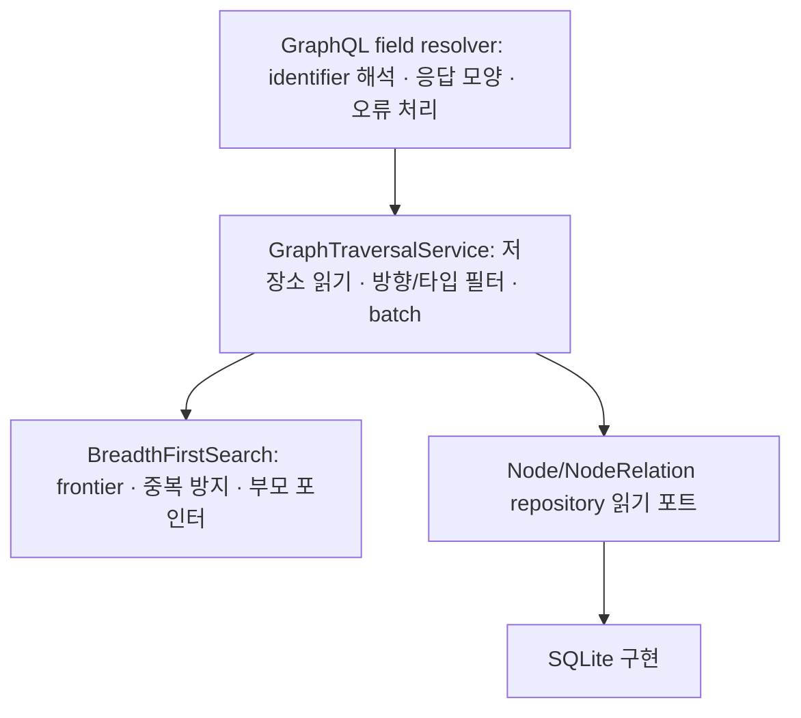

# GraphQL 필드 탐색 계약과 계층 경계

이 문서는 GraphQL `NodeFieldResolvers`와 legacy `NodeResolver`가 공유하는
`connectedNodes`와 `shortestPath` 경계를 설명한다.
REST 경로, SQL recursive CTE, `RelationQueries`는 별도 구현이며 같은 의미와 제한을 공유한다고
가정하지 않는다. API 형태의 정본은
[GraphQL SDL](../../src/presentation/graphql/schema/types/node.graphql)이다.

## 책임 분리



[BFS 상태](../../src/domain/services/graph/BreadthFirstSearch.ts)는 import가 없는 동기 모듈이다.
GraphQL, SQLite, domain entity를 알지 못하며 문자열 node ID와 generic edge만 다룬다.
리졸버가 관계 identifier를 실제 ID로 해석하고,
[서비스](../../src/application/services/GraphTraversalService.ts)가 인접 목록을 읽어 한 레벨씩 전달한다.
알고리즘이 사용할 저장소 포트는 `findByIds`, `findBySourceNodeId`, `findByTargetNodeId`뿐이다.

Kuzu의 [Graph 읽기 인터페이스](https://github.com/kuzudb/kuzu/blob/89f0263cc7a1fd9c396d2c4953747a013556a7f9/src/include/graph/graph.h)와
[single-parent 경로 상태](https://github.com/kuzudb/kuzu/blob/89f0263cc7a1fd9c396d2c4953747a013556a7f9/src/include/function/gds/bfs_graph.h)에서
책임 분리 원칙을 참고했다. C++ 구현을 복제하거나 Kuzu 런타임을 연결한 변경은 아니다.

## 관측 가능한 동작

| 항목 | 계약 |
|---|---|
| `connectedNodes.depth` | 최대 hop 수, 기본 1. 명시적 `0`은 빈 배열이다. 음수는 빈 배열이다. |
| 방문·중복 | 레벨 순서 BFS, node ID당 최초 발견 한 번. 시작 노드는 공개 결과에서 제외한다. |
| 방향 | `OUTGOING`, `INCOMING`, 기본 `BOTH`. 방향에 맞는 저장소 읽기를 수행한다. |
| 관계 필터 | GraphQL 입력은 identifier. 리졸버에서 ID로 바꾼 뒤 발견 전에 필터링한다. 미지정은 전체, 빈 목록/모두 미확인인 identifier는 관계를 확장하지 않는다. |
| `shortestPath.maxDepth` | 기본 6. 경계 hop까지 도달할 수 있다. 방향은 `BOTH`이며 관계 타입 필터는 없다. |
| 최단의 의미 | 최소 hop 경로 한 개. 관계 `strength`를 가중 비용으로 사용하지 않는다. |
| 동률 | frontier 순서와 저장소 인접 목록 순서에서 먼저 발견한 부모를 유지한다. 저장소에 전역 정렬을 추가한 보장은 없다. |
| 경로 응답 | 시작에서 목표까지 순서대로 node를 반환한다. 같은 시작/목표는 0-hop이며, 경로가 없으면 빈 배열이다. |
| 0-hop 부가 동작 | 최단 경로의 시작/목표 일치 확인은 깊이 중단보다 먼저 한다. 음수 `maxDepth`도 같은 ID이면 기존처럼 0-hop 후보를 복원한다. |
| 노드 적재 | 한 번의 `findByIds`에 최대 500개. 반환 순서와 무관하게 탐색/경로 순서로 조립한다. |
| 인접 적재 | 최대 64개 frontier node씩 조회한다. SQLite bulk 경로(`findAdjacentByNodeIds`)는 한 번의 SQL `IN` 조회와 선택적 `relation_type_id IN (...)` pushdown을 사용한다. |
| 탐색 상한 | `GraphTraversalService`는 기본 `maxTraversalDepth = 32`, `maxVisitedNodes = 50_000` 상한으로 무제한 그래프 확장을 차단한다. |
| 존재하지 않는 node | 연결 탐색은 node를 적재하지 못하면 그 지점을 확장하지 않는다. 최단 경로는 기존처럼 관계를 따라 찾고 마지막 node 적재에서 없는 항목을 제외한다. |
| 일관성·범위 | 새 snapshot transaction이나 table 격리 정책을 도입하지 않는다. 저장소/요청 접근 제어의 기존 경계를 따른다. |

마지막 두 행은 후속 설계 대상이다. 탐색 중 삭제가 일어날 때의 snapshot 의미와 경로 중간
node의 누락 처리, 여러 table에 걸친 탐색 범위는 별도 결정 없이 이 모듈이 보장하지 않는다.
`depth=0`은 기존의 `|| 1` 처리에서 `?? 1`로 바꿔 명시적인 0을 존중하도록 수정했다.
`shortestPath`는 양쪽 frontier 중 더 작은 쪽을 먼저 확장하는 `BidirectionalBreadthFirstSearch`를 사용해
분기 계수 `b`, 깊이 `d` 그래프에서 탐색 공간을 `O(b^d)`에서 `O(b^(d/2))`로 줄이며, N-hop 거리 맵이 필요한
하이브리드 검색(`connectedNodeDistances`)은 단방향 레벨 순서 `BreadthFirstSearch`를 사용한다.

`findAdjacentByNodeIds` bulk 포트는 SQLite 관계 저장소에 적용되어 있으며, 복합 인덱스
`idx_node_relations_src_type_dst`와 `idx_node_relations_dst_type_src` 위에서 `relation_type_id IN (...)`
조건을 SQL 단계로 pushdown한다. bulk 메서드가 없는 저장소는 기존 per-node fallback을 사용한다. bulk 전환은 SQL round trip을 줄이지만 snapshot
transaction이나 새로운 table scope 정책을 만들지 않으며, 기존 SQLite 일관성 범위를 따른다.
GraphQL 로그에는 node batch 수, 요청/적재 node 수, adjacency batch 수, bulk/per-node 호출 수,
적재 관계 수, 최대 frontier, elapsed time을 남긴다. 이 값은 응답 계약이 아니며 최적화 비교용
관측치다. `elapsedMs`는 저장소 왕복과 entity 적재를 포함하고 GraphQL/HTTP 전체 왕복은 포함하지 않는다.

## 알고리즘 비용과 검증

frontier에는 node ID만 두고, 발견 시 node당 부모 ID와 edge 하나를 저장한다.
전체 경로는 `pathTo()`를 요청할 때 역방향으로 추적한 뒤 한 번 뒤집는다.
BFS 상태는 방문한 node 수에 대해 O(V), 경로 복원은 길이에 대해 O(L)이다.
이 표기는 저장소 조회, 인접 목록 materialization, 반환 node entity의 메모리는 제외한다.
기존 경로/관계 배열의 frontier별 복사를 제거했다는 구조적 개선이며, 실행 시간 개선율은 측정하지 않았다.

[알고리즘 테스트](../../tests/unit/breadth-first-search.test.ts)는 self-loop를 제외한 3-node 방향 그래프
64개 전체의 모든 시작/목표 조합을 독립적인 Floyd–Warshall 거리와 대조한다.
self-loop·parallel edge·cycle·동률·누락된 인접 목록은 별도 fixture로 검증하고,
10,000-hop 경로를 재귀 없이 복원한다.
[서비스/리졸버 테스트](../../tests/unit/node-field-resolvers-graph-traversal.test.ts)는
방향·타입 필터·명시적 depth 0·경계 최단 경로·1,001개 frontier의 batch·적재 순서를 검증한다.

```bash
bun test tests/unit/breadth-first-search.test.ts \
  tests/unit/node-field-resolvers-graph-traversal.test.ts \
  tests/unit/sqlite-graph-repository-traversal.test.ts \
  tests/unit/strongly-connected-components.test.ts
```

문서·SDL·테스트의 변경 순서는 [문서 관리 정책](../development/DOCUMENTATION_POLICY.md)을 따른다.
