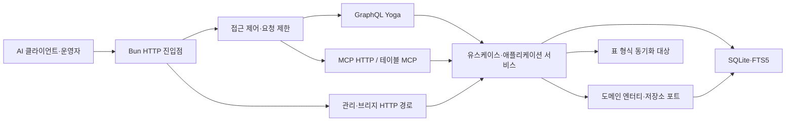

# Bun Graph DB 아키텍처 개요

Bun Graph DB는 Bun 프로세스 하나와 SQLite 데이터베이스 하나를 중심으로 동작하는 모듈형 모놀리스다. 테이블·노드·관계·템플릿을 같은 도메인 모델로 관리하고, GraphQL, MCP, 제한된 HTTP API가 같은 유스케이스와 저장소를 공유한다. 이 구조는 배포와 백업을 단순하게 유지하면서 AI 클라이언트에 MCP 도구와 GraphQL 쿼리를 함께 제공하기 위한 선택이다.

이 문서는 현재 구조와 그 운영 경계를 설명한다. API의 개별 인수와 응답은 [API 문서](../api/)를, MCP 요청 형식은 [MCP 문서](../mcp/README.md)를, 실무 기동·권한·마이그레이션·백업 절차는 [운영 및 관리 가이드](../guides/OPERATIONS_GUIDE.md)를, 운영 준비도 요구사항과 완료 조건은 [명세 008](../../specs/008-production-readiness/spec.md)을 기준으로 한다.

## 서비스 경계

프로세스는 `index.ts`에서 CLI·환경 설정을 읽고 DI 컨테이너, SQLite 연결, GraphQL 스키마, MCP 서버와 HTTP 라우트 핸들러를 생성한 뒤 `Bun.serve`로 노출한다. 기본 호스트는 `0.0.0.0`이므로, 실제 배포에서는 방화벽 또는 역방향 프록시로 외부 노출 범위를 명시해야 한다. SQLite 파일 경로는 `--database-path`, `DATABASE_PATH`, 기본값 `./data/bun-graph-db.sqlite` 순으로 결정된다.

단일 SQLite 파일은 단일 서비스·지속 볼륨에 적합하다. 여러 인스턴스가 같은 파일을 쓰거나 네트워크 파일 시스템 위에서 고가용성을 구성하는 배포 모델은 이 문서의 범위가 아니다. 그 요구가 생기면 저장소와 작업 전달 경계를 별도 서비스 또는 서버형 데이터베이스에 맞춰 다시 설계해야 한다.

## 계층과 의존성

소스 트리는 다음 책임으로 나뉜다.

| 계층 | 주요 위치 | 책임 |
| --- | --- | --- |
| Domain | `src/domain/` | 엔터티, 값 객체, 저장소 인터페이스, 도메인 서비스 |
| Application | `src/application/` | 유스케이스, DTO, 포트, 권한 판정, MCP 도구 계약 |
| Infrastructure | `src/infrastructure/` | Bun SQLite 구현체, DI, 로깅, 백업, Excel·Sheets 어댑터 |
| Presentation | `src/presentation/` | GraphQL 스키마·리졸버, Bun HTTP 어댑터·경로, 테이블 MCP 팩토리 |
| MCP transport | `src/mcp/http-server/` | JSON-RPC HTTP 처리와 MCP 프로토콜 호환 |

의도된 의존 방향은 Presentation과 Infrastructure가 Application·Domain을 사용하고, Application은 Domain의 포트에 의존하는 방식이다. DI 부트스트랩은 데이터베이스, 저장소, 유스케이스, GraphQL 순서로 구현체를 등록한다. 따라서 테스트는 도메인과 유스케이스를 실제 HTTP 서버 없이 검증하고, 통합 테스트는 동일한 컨테이너 조립 경로를 사용할 수 있다.

경계가 완전히 엄격한 것은 아니다. 표 형식 동기화처럼 애플리케이션 서비스가 인프라 구현 타입을 직접 사용하는 부분이 남아 있다. 새 기능은 이 결합을 더 넓히기보다 포트 또는 명시적인 작업 인터페이스를 추가해 의존 방향을 보존해야 한다.

GraphQL의 `NodeFieldResolvers`와 legacy `NodeResolver` 탐색은 `GraphTraversalService`에 저장소 읽기와 batch를,
`BreadthFirstSearch`에 frontier·중복 방문·경로 복원을 맡긴다. 리졸버에는 관계 identifier 해석과
응답 처리를 둔다. 적용 범위와 기존 별도 탐색 경로는 [필드 탐색 계약](./graph-traversal.md)을 따른다.

## 요청 경로와 외부 계약

`index.ts`의 단일 요청 핸들러는 인증 후 정적 화면, 파일·동기화·스키마 경로, 테이블 MCP, 전용 `BunApiRouter`, 루트 MCP, GraphQL을 순서대로 조립한다. `BunApiRouter`는 Bun `Request`를 기존 컨트롤러 계약에 맞추는 어댑터를 통해 REST 디스패치만 담당하므로, 서비스 기동·보안·종료 책임과 REST 경로 책임이 분리된다. GraphQL 스키마 빌더도 Query·Mutation 루트 조립을 별도 resolver 모듈에 위임한다. 주요 공개 경로는 다음과 같다.

| 경로 | 역할 | 주된 소비자 |
| --- | --- | --- |
| `/` | 관리용 정적 HTML | 운영자 |
| `/graphql` | GraphQL Yoga 스키마와 리졸버 | 애플리케이션·AI 브리지 |
| `/mcp` | 루트 MCP JSON-RPC HTTP 서버 | MCP 클라이언트 |
| `/sub/:tableId/mcp` | 한 테이블로 제한된 MCP 서버 | 테이블 전용 MCP 클라이언트 |
| `/schema`, `/schema.json`, `/introspection.json`, `/schema/typescript` | GraphQL 스키마 산출물 | 개발 도구·통합 |
| `/api/*` | 관리·호환·MCP 브리지와 표 동기화 HTTP 경로 | 기존 통합·운영 화면 |

REST 경로는 기능상 GraphQL과 같은 유스케이스를 호출하지만, 요청 핸들러가 컨트롤러에 도달하기 전에 같은 접근 제어 경계를 통과한다. `/api/health`, `/`, `OPTIONS`만 익명 상태 확인·브라우저 preflight를 위해 예외다. 새 외부 경로는 명시적으로 분류되기 전까지 전역 admin 작업으로 닫히므로, REST를 추가할 때는 경로·HTTP 메서드·테이블 또는 노드 범위에 맞는 권한 분류와 회귀 테스트를 함께 추가해야 한다.

## 접근 제어와 감사

`AccessControl`은 production에서 기본적으로 인증을 요구한다. `BUN_GRAPH_DB_ACCESS_TOKENS`는 토큰별 주체 ID, 역할(`reader`, `writer`, `admin`), 허용 테이블 목록을 지정하고, `BUN_GRAPH_DB_API_TOKEN`은 기존 배포용 전역 admin 호환 토큰이다. 명시적으로 `BUN_GRAPH_DB_AUTH_REQUIRED=false`인 개발 환경만 익명 접근을 허용한다.

MCP, 테이블 MCP, GraphQL, 스키마, REST 경로는 요청 크기·Origin·빈도·GraphQL 필드 복잡도를 확인한 뒤 역할과 테이블 범위를 판정한다. 스키마 산출물, 파일 시스템 백업·복원, 전역 DDL·관리 경로는 admin 범위가 필요하다. GraphQL은 루트 필드마다 실제 사용된 인수와 변수를 독립적으로 AST 분석해 미사용 변수나 다중 루트 필드 끼워넣기를 통한 범위 우회를 차단하며, REST와 GraphQL 모두 `tableId`·`tableIdentifier`·`nodeId`(소속 테이블 역추적)를 토큰의 테이블 ID/식별자와 양방향 대조한다. 알 수 없거나 불완전한 MCP 호출은 admin으로, 명시적으로 분류되지 않은 외부 경로도 전역 admin으로 취급한다. 범위를 벗어나거나 소속 테이블을 확인할 수 없는 리소스 요청은 존재 여부를 드러내지 않는 응답으로 거부한다. 접근 로그에는 주체, 엔드포인트, 작업, 테이블만 기록하며 토큰과 원문 인수는 기록하지 않는다.

MCP의 내부 GraphQL·REST 브리지는 주소나 `X-*` 헤더를 신뢰하지 않는다. 단일 프로세스 안에서는 TCP loopback 소켓 왕복 대신 프로세스 내 `FetchLike`(`inProcessFetch`) 핸들러를 직접 호출하지만, 인증이 켜진 배포에서는 동일하게 최소 32자 `BUN_GRAPH_DB_INTERNAL_BRIDGE_TOKEN`을 Bearer 자격 증명으로 전달해 일반 `AccessControl` 검증 경로를 그대로 통과한다. 또한 테이블 MCP의 GraphQL 실행 경로는 정규식 대신 GraphQL AST 분석(`extractReferencedGraphqlScope`)으로 mutation 여부와 참조 테이블·노드 범위를 강제한다.

이 보안 모델은 애플리케이션 계정·SSO·멀티테넌트 저장소를 제공하지 않는다. 현재 명세의 경계는 HTTP 요청을 신뢰할 수 있는 역할·테이블 범위로 연결하는 데 있으며, 정교한 조직·사용자 관리가 필요하면 별도 인증 계층을 앞단에 두어야 한다.

## GraphQL과 MCP의 관계

GraphQL은 데이터 모델과 유스케이스에 접근하는 주 API다. Yoga 컨텍스트는 요청 ID, 요청 수명 데이터와 보안 주체를 리졸버에 전달한다. GraphQL mutation이 성공하면 자동 영속화 서비스가 백업 대상 변경을 표시한다.

MCP는 GraphQL을 대체하는 두 번째 데이터 모델이 아니다. 루트 MCP 도구는 `McpToolRegistry`의 단일 계약에서 이름, 설명, 입력 JSON Schema, GraphQL 작업, `read` 또는 `write` 성격, 범위를 얻는다. 이 계약은 `tools/list`, 입력 검증, 호출 권한 판정과 OpenAPI 투영에 공통으로 사용된다. 테이블 MCP는 같은 계약을 바탕으로 해당 테이블에서 허용된 도구와 템플릿만 노출한다.

루트 MCP HTTP 서버는 MCP `2026-07-28`의 요청별 메타데이터 경로와 `2025-06-18`, `2024-11-05` 초기화 기반 클라이언트를 함께 처리한다. 최신 요청은 `params._meta`와 `MCP-Protocol-Version`, `Mcp-Method` 헤더가 일치해야 하며, `tools/call`은 `Mcp-Name`도 확인한다. 역할 또는 테이블 범위에 따라 도구 목록이 달라질 수 있으므로, 인증된 요청의 도구 목록은 개인 범위로 취급해야 한다.

## 데이터, 검색, 백업

SQLite는 테이블, 노드, 속성, 관계, 임베딩, 템플릿과 운영 상태를 보관한다. 시작 시 `schema_migrations` 원장과 순방향 마이그레이션(현재 버전 `1..13`)을 적용한다. 주요 단계는 기본 스키마, 노드 메타데이터, 노드·속성 FTS5(`node_search_fts`, `node_attribute_search_fts`), 표 동기화 설정·이벤트·작업, EAV 수치 투영 컬럼(`value_num` 및 부분 B-Tree 인덱스), 관계 탐색 복합 인덱스, 영속 `Float32Array` 노드 임베딩(`node_embeddings`, `node_embedding_revisions`)이다. 각 마이그레이션의 DDL과 원장 기록은 하나의 SQLite 트랜잭션으로 커밋한다.

데이터베이스에 이 바이너리가 알 수 없는 더 새 버전이 있거나, 적용된 버전과 이름이 현재 정의와 다르거나, DDL이 실패하면 연결을 닫고 기동을 실패시킨다. 따라서 서버는 부분 적용된 스키마를 정상 상태로 취급하지 않는다. 마이그레이션은 forward-only이므로, 운영자는 배포 전 백업과 복원 검증을 수행하고 롤백은 이전 바이너리 재기동이 아니라 복구 절차로 계획해야 한다.

동적 테이블 속성 변경은 `NodeAttributeSchemaGate` 단일 게이트를 통과해 GraphQL, REST, JSONL 가져오기 모두 동일한 타입·범위·포맷·필수 속성 제약을 강제하며, `/api/tables/:tableId/schema/audit`로 비파괴 정합성 감사를 수행할 수 있다. 노드·속성 텍스트 검색은 `node_search_fts`와 `node_attribute_search_fts` FTS5 BM25 매칭을 사용하고, 수치·날짜 범위 조건은 `node_attributes.value_num` 부분 B-Tree 인덱스로 SQL 단계에서 pushdown한다. 하이브리드 검색(`HybridSearchNodesUseCase`)은 선택적 N-hop 그래프 이웃 탐색, 타입 속성 필터, FTS5 BM25, 영속 `Float32Array` 정확 코사인 유사도를 Reciprocal Rank Fusion(RRF)으로 결합해 GraphQL·REST·MCP에 동일하게 노출한다.

자동 영속화 서비스는 시작 시 복원 후보를 확인하고 정상 종료 시 JSONL 백업을 시도한다. 수동·자동 JSONL 백업(`JsonlBackupService`)은 테이블 스키마·속성, 노드, 관계 타입·관계, 그리고 선택적 영속 임베딩(`includeEmbeddings: true` 시 `embeddings.jsonl`)을 원자적 파일 교체로 내보내고, 빈 데이터베이스나 ID가 변경된 대상 환경에서도 노드 ID 리매핑을 통해 정합성을 유지하며 복원한다. 단, SQLite 파일·백업 디렉터리가 지속 볼륨에 있지 않으면 데이터 보존을 보장하지 않으므로 운영 배포에서는 [운영 및 관리 가이드](../guides/OPERATIONS_GUIDE.md)의 백업·복구 검증 정책을 함께 운영해야 한다.

## 표 형식 동기화

표 동기화는 Bun Graph DB 데이터를 Excel 파일 또는 Google Sheets 대상에 내보내는 단방향 경로다. 활성 설정은 SQLite 또는 구성 파일에서 읽고, 활성화 서비스가 대상 레지스트리와 연결 검사기를 통해 모든 활성 경로의 실제 읽기·쓰기 가능 여부를 확인한 뒤에만 활성 상태를 변경한다. 검사 실패는 기존 활성 설정을 보존한다. `.xlsx`는 SheetJS CE로 작성하며 같은 디렉터리의 임시 파일을 다시 열어 검증한 뒤 원자적으로 교체한다. 쓰기나 검증이 실패하면 기존 파일은 보존한다.

동기화 알림은 `tabular_sync_jobs`에 테이블별 하나의 작업으로 합쳐져 영속된다. 작업은 `queued`, `running`, `retry_wait`, `paused`, `succeeded`, `failed` 상태, 시도 횟수, 다음 시도 시각, 오류, 개정 번호를 가진다. 새 알림은 개정 번호를 증가시켜 실행 중 도착한 변경도 다음 실행에서 전달되게 한다.

작업자는 SQLite 트랜잭션에서 작업 하나를 60초 임대로 원자적으로 claim한다. 시작 시 남아 있는 `running` 작업과 만료된 임대는 재시도 대기열로 되돌아가므로, 프로세스 중단이 대기 작업을 버리지 않는다. 실패는 최대 다섯 번까지 1초부터 지수적으로 늘어나고 최대 60초로 제한된 지연 뒤 다시 시도하며, 한도를 넘으면 `failed`로 끝난다. 운영자는 `/api/tabular-sync-status/:tableIdentifier/pause`, `resume`, `retry`로 작업을 제어하고 상태·이벤트 이력에서 결과를 확인할 수 있다. 양방향 동기화와 외부 표를 원본 데이터베이스로 취급하는 동작은 범위 밖이다.

## 기동, 종료, 배포 시 고려사항

서비스는 포트 사용 가능 여부를 먼저 확인한 뒤 HTTP 서버를 기동한다. `SIGINT`와 `SIGTERM`에서는 새 연결 수락을 중지하고 자동 백업을 시도한다. 루트 MCP 서버와 테이블 MCP 서버는 idempotent `close()`를 제공한다. 닫힌 루트 MCP 서버는 이후 요청에 server-unavailable JSON-RPC 오류를 반환하고, 테이블 서버와 팩토리는 도구·스키마 캐시를 해제한다.

DI 컨테이너는 singleton을 생성의 역순으로 정리하며 `Symbol.asyncDispose`, `Symbol.dispose`, `dispose`, `close`를 지원한다. 이 정리 경로로 SQLite 같은 인프라 자원을 transport 코드에 중복하지 않고 해제할 수 있다. 현재 종료 경로는 HTTP 서버 중지, 루트·테이블 MCP `close()`의 완료 대기, DI 컨테이너 해제를 순서대로 수행한다. MCP 종료 중 하나라도 실패하면 SQLite를 해제하기 전에 종료를 실패로 기록한다.

운영 배포는 다음 조건을 만족해야 한다.

- `NODE_ENV=production`과 지속 가능한 `DATABASE_PATH`를 설정한다.
- `BUN_GRAPH_DB_ACCESS_TOKENS`와 허용 Origin, 요청 한도, GraphQL 복잡도 한도를 환경별로 설정한다.
- `/api/*`를 포함한 모든 외부 경로를 현재 서비스의 인증·권한·감사 경로를 거쳐 노출하고, 역방향 프록시에서도 같은 Origin·TLS 정책을 적용한다.
- SQLite 파일과 자동 백업 산출물을 같은 수명 주기의 영속 디스크에 두고, 복원 절차를 정기적으로 연습한다.
- 한 SQLite 파일의 동시 쓰기 특성을 고려해 단일 writer 서비스로 배포한다.

## 현재 한계와 재검토 조건

이 구조는 한 서비스와 한 운영 팀이 관리하는 그래프 저장소에 적합하다. 데이터가 여러 독립 조직에 분할되거나, 별도의 처리량 확장·고가용성·글로벌 작업 큐가 필요해지면 단일 SQLite와 프로세스 내 동기화 모델을 재검토해야 한다. 영속 `Float32Array` 정확 코사인 기반 하이브리드 검색은 내장되어 있으나, 대규모 근사 최근접 이웃(HNSW ANN) 인덱스, 외부 SSO/OAuth IdP, 다중 테넌트 데이터 분리는 현재 범위 밖이며 필요할 때 권한 모델과 검색 평가 기준을 먼저 확장한 뒤 추가해야 한다.

문서에 설명된 보안·MCP·검색·동기화의 기준선은 [명세 008](../../specs/008-production-readiness/spec.md)이다. 구현 변경이 이 경계를 넓히면 계약 테스트, 운영 문서, 이 개요를 같은 변경에서 함께 갱신한다.
