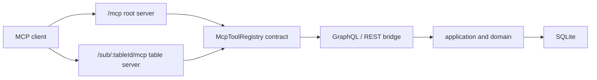

# MCP 시스템 아키텍처

Bun Graph DB의 MCP는 GraphQL을 대체하는 별도 데이터 모델이 아니라, 같은 유스케이스와 저장소를 AI 클라이언트가 도구 형태로 사용할 수 있게 하는 HTTP 전송 경계다. 도구의 공개 계약은 하나이고, 루트와 테이블 범위 MCP 서버가 그 계약을 서로 다른 권한·범위로 투영한다.

## 구성

`McpToolRegistry`는 이름, 설명, 입력 JSON Schema, 읽기·쓰기 성격, 전역·테이블 범위를 제공한다. `tools/list`와 `tools/call`은 이 계약을 공유하므로, 새 도구는 GraphQL 구현과 계약 메타데이터를 함께 변경해야 한다. 호출 주체가 `reader`이면 write 도구는 발견되지 않는다.

테이블 MCP 서버는 테이블 ID를 요청 경로에서 고정한다. 루트 MCP의 테이블 범위 도구와 마찬가지로, 권한 판정은 계약의 범위와 실제 요청 대상에 따라 수행된다.

## 전송과 수명주기

루트 MCP 서버는 `2026-07-28` stateless 요청을 기본으로 처리하며, `2025-06-18`과 `2024-11-05` initialize 기반 클라이언트도 호환한다. 최신 요청은 HTTP 헤더와 `params._meta`의 프로토콜 정보가 일치해야 한다.

서버 종료 시 루트 MCP와 생성된 테이블 MCP 서버는 모두 `close()`된다. 종료된 서버는 새 요청을 처리하지 않으며, 테이블별 도구와 스키마 캐시가 해제된다. 이후 DI 컨테이너가 SQLite와 다른 singleton 리소스를 생성 역순으로 정리한다.

## 보안 경계

외부 MCP 요청은 REST·GraphQL과 같은 접근 제어를 통과한다. 역할, 테이블 범위, 요청 크기, Origin, 요청 빈도와 도구의 read·write 성격이 권한 판정에 사용된다. 내부 GraphQL·REST 브리지는 loopback 주소만 신뢰하지 않고 `BUN_GRAPH_DB_INTERNAL_BRIDGE_TOKEN`을 Bearer 자격 증명으로 전달한다.

요청 형식, 환경 변수, 검증 명령은 [MCP 참조](./README.md)에서 확인한다. 전체 서비스의 요청 경계와 데이터 흐름은 [아키텍처 개요](../architecture/overview.md)를 따른다.
