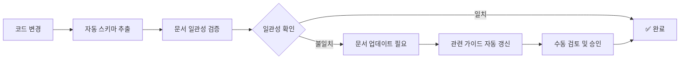

# GraphQL API 개발 환경 구성 가이드

이 가이드는 bun-graph-db GraphQL API의 개발, 테스트, 검증을 위한 체계적인 환경 구성과 워크플로우를 제공합니다.

## 📋 목차

1. [개발 환경 구성](#개발-환경-구성)
2. [가이드 문서 체계](#가이드-문서-체계)
3. [순차적 개발 워크플로우](#순차적-개발-워크플로우)
4. [품질 관리 프로세스](#품질-관리-프로세스)
5. [문서 유지보수 가이드라인](#문서-유지보수-가이드라인)

## 개발 환경 구성

### 🚀 핵심 개발 스택

```typescript
// 개발 환경 구성
{
  "runtime": "Bun",
  "database": "SQLite (bun:sqlite)",
  "graphql": "GraphQL Yoga + GraphQL Tools",
  "architecture": "Clean Architecture (5-layer)",
  "di": "Custom DIContainer with TypeScript",
  "testing": "Bun Test + Custom Fixtures"
}
```

### 📁 개발 환경 디렉터리 구조

```
/Users/junwoobang/project/bun-graph-db/
├── 🏗️ 개발 환경 파일
│   ├── index.ts                   # GraphQL 서버 엔트리포인트
│   ├── package.json               # 의존성 및 스크립트 관리
│   └── tsconfig.json              # TypeScript 설정
│
├── 📚 가이드 문서 (refactoring/)
│   ├── DEVELOPMENT_ENVIRONMENT_GUIDE.md    # 📍 이 파일
│   ├── GRAPHQL_API_CHECKLIST.md           # 📋 API 기능 체크리스트
│   ├── TEMPLATE_GRAPHQL_INTERACTION_GUIDE.md # 🔄 템플릿 시스템 가이드
│   ├── FOLDER_STRUCTURE.md                # 🏗️ 아키텍처 구조
│   └── TEMPLATE_SPECIFICATION.md          # 📝 템플릿 스펙
│
├── 🔧 개발 도구 (scripts/)
│   ├── setup-test-dataset.ts     # 테스트 데이터 생성
│   ├── setup-test-environment.ts # 테스트 환경 구성
│   └── comprehensive-test-runner.ts # 종합 테스트 실행
│
├── 🧪 테스트 환경 (tests/, test/)
│   ├── template-based-node-mutations.test.ts
│   ├── graphql-comprehensive.test.ts
│   └── utils/TestDataFixtures.ts
│
└── 💾 데이터
    ├── data/bun-graph-db.sqlite   # 개발 데이터베이스
    └── datasets/                  # 테스트 데이터셋
```

### ⚙️ 개발 명령어 정의

```json
{
  "scripts": {
    "dev": "bun run --watch index.ts",
    "start": "bun run index.ts",
    "typecheck": "tsc --noEmit",
    "test": "bun test",
    "test:templates": "bun run scripts/run-template-tests.ts",
    "test:comprehensive": "bun run scripts/comprehensive-test-runner.ts",
    "setup:data": "bun run scripts/setup-test-dataset.ts",
    "setup:env": "bun run scripts/setup-test-environment.ts",
    "validate:api": "bun run scripts/graphql-api-validator.ts"
  }
}
```

## 가이드 문서 체계

### 📚 문서 계층 구조

```
가이드 문서 체계
├── 🎯 핵심 가이드 (이 파일)
│   └── DEVELOPMENT_ENVIRONMENT_GUIDE.md
│
├── 📋 기능 관리
│   ├── GRAPHQL_API_CHECKLIST.md      # API 기능 상태 추적
│   └── TEMPLATE_SPECIFICATION.md     # 템플릿 시스템 명세
│
├── 🔄 상호작용 가이드
│   └── TEMPLATE_GRAPHQL_INTERACTION_GUIDE.md # 템플릿-GraphQL 연동
│
├── 🏗️ 아키텍처 가이드
│   ├── FOLDER_STRUCTURE.md           # 프로젝트 구조
│   ├── DEPENDENCY_INJECTION_SPEC.md  # DI 시스템 명세
│   └── GRAPHQL_SEPARATION_SPEC.md    # GraphQL 모듈화
│
└── 📖 확장 가이드
    ├── EXTENSION_GUIDELINES.md       # 기능 확장 가이드라인
    └── API_USAGE_EXAMPLES.md         # API 사용 예제
```

### 🔗 문서 간 상호참조 매핑

```typescript
interface DocumentRelationship {
  // 핵심 참조 관계
  "DEVELOPMENT_ENVIRONMENT_GUIDE.md": {
    references: [
      "GRAPHQL_API_CHECKLIST.md",        // 기능 구현 상태 확인
      "TEMPLATE_GRAPHQL_INTERACTION_GUIDE.md" // 템플릿 시스템 이해
    ],
    updatedBy: [
      "새로운 API 추가 시",
      "개발 워크플로우 변경 시",
      "테스트 환경 구성 변경 시"
    ]
  },
  
  "GRAPHQL_API_CHECKLIST.md": {
    references: [
      "TEMPLATE_SPECIFICATION.md",       // 템플릿 관련 API 이해
      "FOLDER_STRUCTURE.md"              // 리졸버 구조 이해
    ],
    updatedBy: [
      "새로운 Query/Mutation 추가 시",
      "API 시그니처 변경 시",
      "기능 구현 완료 시 (체크박스 업데이트)"
    ]
  },
  
  "TEMPLATE_GRAPHQL_INTERACTION_GUIDE.md": {
    references: [
      "GRAPHQL_API_CHECKLIST.md",        // 관련 API 확인
      "TEMPLATE_SPECIFICATION.md"       // 템플릿 스펙 참조
    ],
    updatedBy: [
      "템플릿 실행 로직 변경 시",
      "GraphQL 스키마 변경 시",
      "새로운 템플릿 패턴 추가 시"
    ]
  }
}
```

## 순차적 개발 워크플로우

### 🎯 Phase 1: 핵심 CRUD API 구현

#### 1.1 기본 노드 관리 API
```typescript
// 우선순위 1: 필수 노드 작업
const Phase1Priority1 = [
  // Query
  "node",                    // 단일 노드 조회
  "nodes",                   // 노드 목록 조회
  "nodeByContent",          // 컨텐츠로 노드 조회
  
  // Mutation  
  "createNode",             // 노드 생성
  "updateNode",             // 노드 수정
  "deleteNode",             // 노드 삭제
]

// 개발 체크리스트
const developmentChecklist = {
  "단계별 검증": [
    "✅ GraphQL 스키마 정의 완료",
    "✅ 리졸버 구현 완료", 
    "✅ UseCase 레이어 구현 완료",
    "✅ Repository 레이어 구현 완료",
    "✅ 단위 테스트 작성 완료",
    "✅ 통합 테스트 작성 완료",
    "✅ GraphiQL에서 수동 테스트 완료",
    "✅ API 문서 업데이트 완료"
  ]
}
```

#### 1.2 테이블 관리 API
```typescript
// 우선순위 2: 테이블 스키마 관리
const Phase1Priority2 = [
  // Query
  "table",                   // 단일 테이블 조회
  "tables",                  // 테이블 목록 조회
  "tableByIdentifier",       // 식별자로 테이블 조회
  
  // Mutation
  "createTable",             // 테이블 생성
  "updateTable",             // 테이블 수정
  "deleteTable"              // 테이블 삭제 (주의: 데이터 손실)
]
```

### 🔗 Phase 2: 관계 및 속성 API 구현

#### 2.1 관계 관리 API
```typescript
const Phase2Priority1 = [
  // Query
  "nodeRelations",           // 관계 목록 조회
  "searchRelatedNodes",      // 관련 노드 검색
  "relationType",            // 관계 타입 조회
  "relationTypes",           // 관계 타입 목록
  
  // Mutation
  "createRelation",          // 관계 생성
  "deleteRelation",          // 관계 삭제
  "createRelationType"       // 관계 타입 생성
]
```

#### 2.2 속성 스키마 API
```typescript
const Phase2Priority2 = [
  // Query
  "attributes",              // 테이블별 속성 정의 목록
  "attributeTypes",          // 속성 타입 목록
  "attributeTypeByIdentifier", // 식별자로 속성 타입 조회
  
  // Mutation  
  "createAttribute",         // 속성 정의 생성
  "createAttributeType",     // 속성 타입 생성
  "setNodeAttribute"         // 노드 속성 설정
]
```

### 🎯 Phase 3: 템플릿 시스템 API 구현

#### 3.1 템플릿 관리 API
```typescript
const Phase3Priority1 = [
  // Query
  "getTemplate",             // 템플릿 조회
  "searchTemplates",         // 템플릿 검색
  "getPopularTemplates",     // 인기 템플릿 조회
  
  // Mutation
  "createTemplate",          // 템플릿 생성
  "updateTemplate",          // 템플릿 수정
  "activateTemplate",        // 템플릿 활성화
  "executeTemplate"          // 템플릿 실행 (핵심 기능!)
]

// 템플릿 실행 검증 체크리스트
const templateValidationChecklist = {
  "변수 검증": [
    "✅ JSON Schema 기반 변수 타입 검증",
    "✅ 필수 변수 누락 검사",
    "✅ 변수 범위 및 제약조건 검증"
  ],
  "실행 안전성": [
    "✅ GraphQL 쿼리 구문 검증", 
    "✅ SQL Injection 방지 검증",
    "✅ 권한 기반 실행 제어"
  ],
  "성능 최적화": [
    "✅ 쿼리 실행 시간 모니터링",
    "✅ 결과 캐싱 구현",
    "✅ 대용량 결과 처리"
  ]
}
```

### 🔍 Phase 4: 고급 검색 및 분석 API

#### 4.1 검색 및 필터링 API
```typescript
const Phase4Priority1 = [
  // Query
  "advancedSearch",          // 고급 검색 (복합 필터)
  "searchNodes",             // 노드 검색 및 페이지네이션
  
  // 필터링 및 정렬 기능
  "nodeFiltering": {
    "attributeFilters": "속성 값 기반 필터링",
    "relationFilters": "관계 기반 필터링", 
    "dateRangeFilters": "시간 범위 필터링",
    "textSearch": "전문 검색 기능"
  }
]
```

#### 4.2 분석 및 집계 API
```typescript
const Phase4Priority2 = [
  // Query
  "analyzeNodes",            // 노드 네트워크 분석
  "aggregateData",           // 데이터 집계
  "getDependencyChain",      // 종속성 체인 분석
  
  // 분석 기능 검증
  "analyticsValidation": {
    "networkAnalysis": "중심성, 클러스터링, PageRank 계산",
    "statisticalAggregation": "평균, 합계, 분포 분석",
    "dependencyMapping": "종속성 그래프 생성"
  }
]
```

## 품질 관리 프로세스

### 🧪 테스트 전략

#### 단계별 테스트 접근법
```typescript
interface TestingStrategy {
  // Level 1: 단위 테스트
  unitTests: {
    target: "개별 리졸버, UseCase, Repository",
    coverage: ">= 80%",
    tools: ["bun:test", "custom mocks"],
    location: "각 모듈과 동일 디렉터리"
  }
  
  // Level 2: 통합 테스트
  integrationTests: {
    target: "GraphQL API 엔드포인트",
    coverage: "모든 Query/Mutation",
    tools: ["GraphQL Yoga", "TestDataFixtures"],
    location: "tests/ 디렉터리"
  }
  
  // Level 3: E2E 테스트
  e2eTests: {
    target: "실제 사용 시나리오",
    coverage: "주요 워크플로우",
    tools: ["template-based tests", "comprehensive runner"],
    location: "scripts/ 디렉터리"
  }
}
```

#### API 검증 자동화
```typescript
// scripts/graphql-api-validator.ts (새로 생성 예정)
interface APIValidationSuite {
  schemaValidation: {
    "스키마 일관성 검사": "GraphQL 스키마와 TypeScript 타입 일치",
    "필수 필드 검증": "모든 필수 필드 정의 확인",
    "타입 안전성": "입력/출력 타입 검증"
  }
  
  functionalValidation: {
    "CRUD 작업": "기본 생성/조회/수정/삭제 테스트",
    "관계 작업": "노드 간 관계 생성 및 조회 테스트", 
    "템플릿 실행": "다양한 템플릿 패턴 실행 테스트"
  }
  
  performanceValidation: {
    "응답 시간": "< 500ms for simple queries",
    "동시성": "10개 동시 요청 처리",
    "메모리 사용량": "< 100MB for normal operations"
  }
}
```

### 📋 개발 체크리스트 활용

#### GRAPHQL_API_CHECKLIST.md 기반 개발
```typescript
// 매 개발 단계마다 체크리스트 업데이트
interface ChecklistWorkflow {
  "기능 개발 시작": [
    "1. GRAPHQL_API_CHECKLIST.md에서 해당 기능 찾기",
    "2. 기능 요구사항 및 시그니처 확인",  
    "3. 관련 의존성 및 제약사항 파악",
    "4. 개발 시작 전 체크박스 상태 확인"
  ],
  
  "개발 중": [
    "1. 스키마 정의 → 체크리스트 업데이트", 
    "2. 리졸버 구현 → 체크리스트 업데이트",
    "3. 테스트 작성 → 체크리스트 업데이트",
    "4. 문서 업데이트 → 체크리스트 업데이트"
  ],
  
  "개발 완료": [
    "1. 모든 테스트 통과 확인",
    "2. 체크리스트에서 ✅ 완료 표시",
    "3. 관련 가이드 문서 업데이트",
    "4. 다음 우선순위 기능으로 이동"
  ]
}
```

## 문서 유지보수 가이드라인

### 📝 실시간 문서 업데이트 규칙

#### 자동 업데이트 트리거
```typescript
interface DocumentUpdateTriggers {
  "GRAPHQL_API_CHECKLIST.md": {
    triggers: [
      "새로운 Query/Mutation 스키마 추가 시",
      "API 시그니처 변경 시", 
      "기능 구현 상태 변경 시",
      "제거 대상 API 식별 시"
    ],
    updateActions: [
      "체크박스 상태 업데이트 ([ ] → [x])",
      "새 기능 항목 추가 (시그니처, 용도, 구현상태 포함)",
      "구현 주의사항 및 제한사항 업데이트",
      "제거 대상 API ~~취소선~~ 처리"
    ]
  },
  
  "TEMPLATE_GRAPHQL_INTERACTION_GUIDE.md": {
    triggers: [
      "템플릿 실행 로직 변경 시",
      "새로운 템플릿 패턴 추가 시",
      "GraphQL 스키마 변경으로 템플릿 영향 시"
    ],
    updateActions: [
      "새 템플릿 패턴 예제 추가",
      "변수 스키마 샘플 업데이트", 
      "실행 결과 예제 갱신",
      "최적화 가이드 업데이트"
    ]
  }
}
```

#### 일관성 검증 자동화
```typescript
// scripts/validate-documentation.ts (새로 생성 예정)
interface DocumentValidationRules {
  "API 문서 일관성": {
    "스키마 싱크": "GraphQL 스키마와 체크리스트 일치 확인",
    "시그니처 정확성": "실제 리졸버와 문서화된 시그니처 비교",
    "상호참조 유효성": "문서 간 링크 및 참조 검증"
  },
  
  "가이드 완전성": {
    "예제 실행 가능성": "문서의 모든 코드 예제 실행 테스트",
    "단계별 검증": "가이드의 모든 단계 실행 가능 여부",
    "최신성 확인": "코드 변경과 문서 업데이트 동기화"
  }
}
```

### 🔄 문서 동기화 워크플로우

#### 개발 → 문서 업데이트 프로세스


### 🎯 개발 환경 활용 시나리오

#### 시나리오 1: 새로운 노드 검색 API 추가
```typescript
// 1단계: 체크리스트에서 현황 파악
// GRAPHQL_API_CHECKLIST.md → "searchNodes" 항목 확인

// 2단계: 관련 가이드 참조  
// TEMPLATE_GRAPHQL_INTERACTION_GUIDE.md → 노드 조회 템플릿 패턴 학습

// 3단계: 개발 환경에서 구현
// src/presentation/graphql/queries/NodeQueries.ts 수정

// 4단계: 테스트 데이터로 검증
// bun run scripts/setup-test-dataset.ts
// bun run test:comprehensive

// 5단계: 문서 업데이트
// GRAPHQL_API_CHECKLIST.md → ✅ 완료 표시
// 관련 예제 및 제약사항 문서화
```

#### 시나리오 2: 템플릿 시스템 확장
```typescript
// 1단계: 템플릿 명세 확인
// TEMPLATE_SPECIFICATION.md → 새 템플릿 타입 요구사항 파악

// 2단계: GraphQL 상호작용 가이드 참조
// TEMPLATE_GRAPHQL_INTERACTION_GUIDE.md → 기존 패턴 분석

// 3단계: 구현 및 테스트
// 새 템플릿 패턴 구현 → 테스트 케이스 작성

// 4단계: 가이드 업데이트  
// TEMPLATE_GRAPHQL_INTERACTION_GUIDE.md → 새 패턴 예제 추가
// GRAPHQL_API_CHECKLIST.md → 관련 API 체크리스트 업데이트
```

## 🚀 다음 단계

이 환경 구성 가이드를 활용하여:

1. **체계적 개발**: Phase별 우선순위에 따른 순차적 API 개발
2. **품질 보장**: 단계별 테스트 전략으로 안정성 확보  
3. **문서 동기화**: 실시간 가이드 업데이트로 개발 효율성 향상
4. **지속적 개선**: 사용 피드백 기반 워크플로우 최적화

개발 과정에서 이 가이드와 관련 문서들을 항상 최신 상태로 유지하여, 팀 전체가 일관된 개발 환경에서 작업할 수 있도록 관리하겠습니다. 🎯