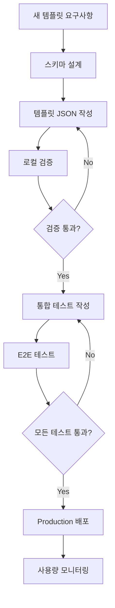

# 🏗️ Template System Master Guide

bun-graph-db의 Template 시스템에 대한 완전 가이드입니다. AI 친화적인 GraphQL 그래프 데이터베이스의 핵심 차별화 기능인 템플릿 시스템을 체계적으로 관리하고 확장하는 방법을 제공합니다.

## 📋 목차

1. [시스템 개요](#-시스템-개요)
2. [디렉토리 구조](#-디렉토리-구조)
3. [핵심 컴포넌트](#-핵심-컴포넌트)
4. [사용법 가이드](#-사용법-가이드)
5. [개발 워크플로우](#-개발-워크플로우)
6. [확장 가이드](#-확장-가이드)
7. [모범 사례](#-모범-사례)
8. [트러블슈팅](#-트러블슈팅)

## 🎯 시스템 개요

### Template 시스템의 핵심 가치
- **AI 친화성**: 구조화된 GraphQL 쿼리 템플릿으로 AI가 쉽게 이해하고 활용
- **재사용성**: 공통 패턴을 템플릿화하여 개발 효율성 극대화
- **타입 안전성**: JSON Schema 기반 변수 검증으로 런타임 오류 방지
- **환경 분리**: Production/Development/Migration 환경별 템플릿 관리
- **확장성**: 도메인별, 복잡도별 템플릿 체계적 관리

### 주요 특징
- ✅ **중앙 집중식 관리**: 모든 템플릿 리소스를 `templates/` 하위에서 통합 관리
- ✅ **다층 검증**: 구조 → 변수 → 실행 가능성의 3단계 검증
- ✅ **Hot Reload**: 개발 환경에서 템플릿 변경 시 자동 리로드
- ✅ **CLI 도구**: 명령줄에서 모든 템플릿 관리 작업 수행
- ✅ **Migration 지원**: 템플릿 스키마 변경 시 마이그레이션 도구 제공

## 📁 디렉토리 구조

```
templates/
├── README.md                    # 시스템 개요 및 구조 설명
├── TEMPLATE_SYSTEM_GUIDE.md     # 이 문서 (마스터 가이드)
├── package.json                 # Template 시스템 전용 의존성
├── schemas/                     # JSON Schema 정의
│   ├── core/                    # 핵심 템플릿 스키마
│   │   ├── node-templates.schema.json
│   │   ├── relation-templates.schema.json
│   │   └── attribute-templates.schema.json
│   ├── domain/                  # 도메인별 특화 스키마
│   │   ├── ecommerce.schema.json
│   │   ├── project-management.schema.json
│   │   └── knowledge-graph.schema.json
│   └── validation/              # 검증 전용 스키마
│       ├── template-structure.schema.json
│       └── variable-types.schema.json
├── datasets/                    # 환경별 템플릿 데이터
│   ├── production/              # 프로덕션 검증된 템플릿
│   │   ├── basic-node-operations.json
│   │   ├── advanced-queries.json
│   │   └── mutation-templates.json
│   ├── development/             # 개발/테스트용 템플릿
│   │   ├── comprehensive-templates.json
│   │   ├── debug-templates.json
│   │   └── experimental-templates.json
│   └── migration/               # 마이그레이션 데이터
│       ├── v1-to-v2/
│       └── legacy-templates.json
├── loaders/                     # 로딩 시스템
│   ├── template-loader.ts       # 메인 로더 (Hot Reload 지원)
│   ├── schema-loader.ts         # 스키마 로더
│   ├── validation-loader.ts     # 검증 설정 로더
│   └── migration-loader.ts      # 마이그레이션 데이터 로더
├── generators/                  # 템플릿 자동 생성
│   ├── basic-template-generator.ts
│   ├── domain-template-generator.ts
│   ├── test-template-generator.ts
│   └── migration-generator.ts
├── validators/                  # 검증 시스템
│   ├── template-validator.ts    # 메인 검증기 (3단계 검증)
│   ├── schema-validator.ts      # JSON Schema 검증
│   ├── variable-validator.ts    # 변수 타입/범위 검증
│   └── execution-validator.ts   # GraphQL 구문 검증
├── tests/                       # 템플릿 전용 테스트
│   ├── unit/                    # 컴포넌트 단위 테스트
│   ├── integration/             # 템플릿 통합 테스트
│   │   └── template-based-node-mutations.test.ts
│   └── fixtures/                # 테스트 데이터
├── examples/                    # 사용법 예제 및 문서
│   ├── basic-usage/             # 기본 사용법 가이드
│   │   ├── sample-node-templates.ts
│   │   └── template-workflow.md
│   ├── advanced-usage/          # 고급 활용법
│   └── domain-examples/         # 도메인별 예제
└── tools/                       # 관리 도구
    ├── template-cli.ts          # CLI 메인 도구
    ├── template-analyzer.ts     # 사용량 분석 도구
    ├── performance-profiler.ts  # 성능 프로파일링
    └── migration-tool.ts        # 스키마 마이그레이션
```

## ⚙️ 핵심 컴포넌트

### 1. Template Loader (`loaders/template-loader.ts`)
**기능**: 환경별 템플릿 로딩 및 캐싱 관리
- 환경별 데이터셋 자동 스캔
- Hot Reload 지원 (개발 환경)
- 메모리 캐싱 최적화
- 로드 성능 메트릭 수집

```typescript
const loader = new TemplateLoader(logger)
const result = await loader.loadTemplates({
  environment: 'development',
  includeExamples: true,
  validateSchemas: true,
  hotReload: true
})
```

### 2. Template Validator (`validators/template-validator.ts`)
**기능**: 3단계 검증 시스템 (구조 → 변수 → 실행)
- JSON Schema 기반 구조 검증
- 변수 타입 및 범위 검증
- GraphQL 구문 및 변수 참조 검증
- 성능 및 보안 경고 생성

```typescript
const validator = new TemplateValidator(logger)
const result = await validator.validateTemplate(template, {
  validateStructure: true,
  validateVariables: true,
  validateExecution: true,
  skipWarnings: false
})
```

### 3. Template CLI (`tools/template-cli.ts`)
**기능**: 명령줄 기반 템플릿 관리 도구
- 환경별 템플릿 로딩 및 조회
- 배치 검증 및 개별 검증
- 템플릿 상세 정보 출력
- JSON/Table/Summary 출력 형식

```bash
# 주요 명령어들
bun templates/tools/template-cli.ts load -e development
bun templates/tools/template-cli.ts list -o table
bun templates/tools/template-cli.ts validate -t template-id
bun templates/tools/template-cli.ts info -t template-id
```

## 🚀 사용법 가이드

### 1. 기본 템플릿 사용

#### 템플릿 로드 및 조회
```bash
# 개발 환경 템플릿 로드
bun templates/tools/template-cli.ts load -e development

# 모든 템플릿 목록 조회
bun templates/tools/template-cli.ts list

# 테이블 형태로 조회
bun templates/tools/template-cli.ts list -o table
```

#### 특정 템플릿 정보 확인
```bash
# 템플릿 상세 정보
bun templates/tools/template-cli.ts info -t create-basic-node

# 템플릿 검증
bun templates/tools/template-cli.ts validate -t create-basic-node
```

### 2. 새로운 템플릿 추가

#### Step 1: JSON 파일에 템플릿 정의
```json
// templates/datasets/development/my-custom-templates.json
{
  "identifier": "my-custom-query",
  "name": "My Custom Query",
  "description": "Custom GraphQL query for specific use case",
  "queryText": "query MyQuery($param: String!) { ... }",
  "templateType": "query",
  "variablesSchema": {
    "type": "object",
    "properties": {
      "param": { "type": "string", "minLength": 1 }
    },
    "required": ["param"]
  },
  "defaultVariables": { "param": "" },
  "tags": ["custom", "query"]
}
```

#### Step 2: 템플릿 검증
```bash
bun templates/tools/template-cli.ts validate -t my-custom-query
```

#### Step 3: 템플릿 테스트
```bash
# 통합 테스트에서 템플릿 실행 테스트
bun test templates/tests/integration/
```

### 3. 환경별 템플릿 관리

#### Production 템플릿 배포
```bash
# Production 환경 검증
bun templates/tools/template-cli.ts validate -e production

# 모든 Production 템플릿 로드
bun templates/tools/template-cli.ts load -e production -v
```

#### Development 템플릿 개발
```bash
# Hot Reload로 개발
bun templates/tools/template-cli.ts load -e development --hot-reload

# 실험적 템플릿 테스트
bun templates/tools/template-cli.ts validate -e development
```

## 🔄 개발 워크플로우

### 1. 템플릿 개발 사이클



### 2. 일일 개발 워크플로우

```bash
# 1. 개발 환경 설정
bun templates/tools/template-cli.ts load -e development --hot-reload

# 2. 새 템플릿 작성 (파일 저장 시 자동 리로드)

# 3. 실시간 검증
bun templates/tools/template-cli.ts validate -t new-template

# 4. 통합 테스트
bun test templates/tests/integration/

# 5. 전체 검증
bun templates/tools/template-cli.ts validate -e development
```

### 3. 배포 워크플로우

```bash
# 1. Development에서 Production으로 이동
cp templates/datasets/development/my-template.json templates/datasets/production/

# 2. Production 환경 검증
bun templates/tools/template-cli.ts validate -e production

# 3. 전체 시스템 테스트
bun run test

# 4. 성능 프로파일링
bun templates/tools/performance-profiler.ts --template-id my-template
```

## 🔧 확장 가이드

### 1. 새로운 도메인 스키마 추가

```json
// templates/schemas/domain/my-domain.schema.json
{
  "$schema": "http://json-schema.org/draft-07/schema#",
  "title": "My Domain Template Schema",
  "allOf": [
    { "$ref": "../core/node-templates.schema.json" },
    {
      "properties": {
        "domainSpecificField": {
          "type": "string",
          "description": "Domain-specific field"
        }
      }
    }
  ]
}
```

### 2. 커스텀 Validator 추가

```typescript
// templates/validators/custom-domain-validator.ts
export class CustomDomainValidator extends TemplateValidator {
  async validateDomainSpecific(template: DomainTemplate): Promise<ValidationResult> {
    // 도메인별 특수 검증 로직
  }
}
```

### 3. 새로운 Generator 개발

```typescript
// templates/generators/ai-assisted-generator.ts
export class AIAssistedGenerator {
  async generateFromDescription(description: string): Promise<TemplateStructure> {
    // AI 기반 템플릿 자동 생성 로직
  }
}
```

## 💡 모범 사례

### 1. 템플릿 설계 원칙

#### ✅ DO
- **단일 책임**: 하나의 템플릿은 하나의 명확한 작업 수행
- **명확한 네이밍**: `create-basic-node`, `search-nodes-by-content`
- **상세한 설명**: 템플릿의 목적과 사용법을 명확히 기술
- **변수 검증**: JSON Schema로 모든 변수의 타입과 제약 조건 정의
- **예제 제공**: 실제 사용 예제를 템플릿에 포함

#### ❌ DON'T
- **모호한 이름**: `query1`, `temp-template`
- **복잡한 로직**: 하나의 템플릿에 여러 작업 포함
- **검증 생략**: 변수 스키마 없는 템플릿 생성
- **문서화 부족**: 설명이나 예제 없는 템플릿

### 2. 성능 최적화

#### 캐싱 전략
```typescript
// 템플릿별 캐싱 전략 설정
{
  "metadata": {
    "performance": {
      "cacheStrategy": "short",  // none, short, medium, long
      "estimatedResponseTime": "<100ms"
    }
  }
}
```

#### 배치 처리
```bash
# 여러 템플릿 동시 검증
bun templates/tools/template-cli.ts validate -e development
```

### 3. 보안 고려사항

#### 위험한 작업 명시
```json
{
  "validation": {
    "requiresAuthentication": true,
    "dangerousOperations": ["delete", "bulk-update"],
    "inputSanitization": true
  }
}
```

#### 변수 검증 강화
```json
{
  "variablesSchema": {
    "type": "object",
    "properties": {
      "userInput": {
        "type": "string",
        "maxLength": 1000,
        "pattern": "^[a-zA-Z0-9 ._-]+$"  // 특수 문자 제한
      }
    }
  }
}
```

## 🐛 트러블슈팅

### 1. 일반적인 문제들

#### 템플릿 로드 실패
```bash
# 문제: 템플릿 파일이 로드되지 않음
# 해결: 파일 경로와 JSON 구문 확인
bun templates/tools/template-cli.ts load -e development --verbose
```

#### 검증 오류
```bash
# 문제: 템플릿 검증 실패
# 해결: 스키마 호환성 확인
bun templates/tools/template-cli.ts validate -t problematic-template --verbose
```

#### Hot Reload 작동 안함
```bash
# 문제: 파일 변경이 반영되지 않음
# 해결: 권한 및 파일 감시 설정 확인
ls -la templates/datasets/development/
```

### 2. 성능 문제

#### 로딩 속도 저하
- **원인**: 너무 많은 템플릿 파일
- **해결**: 파일 분할 및 지연 로딩 적용

#### 검증 속도 저하
- **원인**: 복잡한 JSON Schema
- **해결**: 스키마 최적화 및 캐싱 활용

### 3. 디버깅 도구

#### 상세 로깅 활성화
```bash
bun templates/tools/template-cli.ts load --verbose
```

#### 개별 컴포넌트 테스트
```bash
bun test templates/tests/unit/loaders.test.ts
bun test templates/tests/unit/validators.test.ts
```

## 📞 지원 및 문의

### 내부 리소스
- **README.md**: 시스템 개요 및 기본 구조
- **examples/**: 실제 사용 예제들
- **tests/**: 모든 테스트 케이스 및 픽스처

### 명령어 도움말
```bash
bun templates/tools/template-cli.ts --help
```

### 디버깅 모드
```bash
bun templates/tools/template-cli.ts <command> --verbose
```

---

**이 Template System은 bun-graph-db의 핵심 차별화 기능입니다. AI가 GraphQL을 더 쉽게 이해하고 활용할 수 있도록 설계된 이 시스템을 통해 프로젝트의 진정한 가치를 실현할 수 있습니다.** 🚀